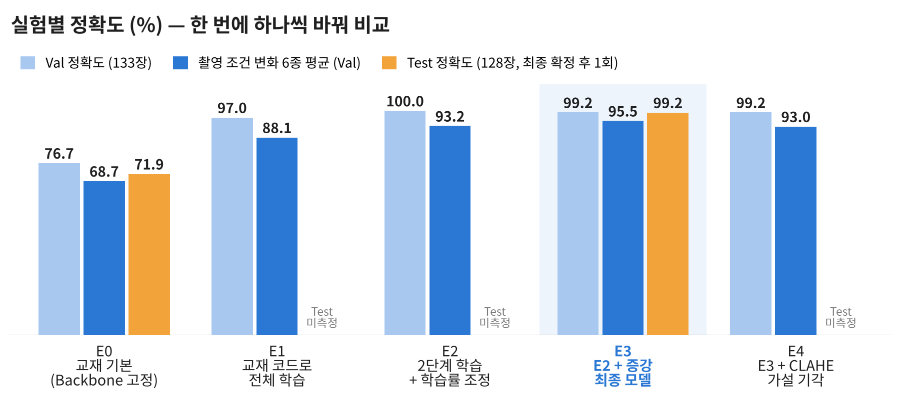

<p align="center">
  
</p>

<h1 align="center">Leaf Health Classifier</h1>

<p align="center">
  <b>콩잎 사진 한 장으로 각진잎반점병 · 녹병 · 정상을 판별하는 Vision AI 웹 서비스</b><br>
  ResNet18 Fine-tuning · FastAPI 동기/비동기 · Redis · Celery · PostgreSQL
</p>

<p align="center">
  
  
  
  
  
  
  
  
</p>

<p align="center">
  <a href="reports/08_최종기술보고서.md"><b>📄 최종 기술보고서</b></a> ·
  <a href="reports/02_시스템_아키텍처.md"><b>🏗 아키텍처</b></a> ·
  <a href="reports/01_FineTuning_결과보고서.md"><b>📊 모델 결과</b></a> ·
  <a href="reports/06_성능비교_보고서.md"><b>⚡ 시스템 성능</b></a> ·
  <a href="reports/07_기능테스트_오류분석.md"><b>✅ 기능 테스트</b></a><br>
  산출물
  <a href="reports/01_FineTuning_결과보고서.md">1</a> ·
  <a href="reports/02_시스템_아키텍처.md">2</a> ·
  <a href="reports/03_API_명세서.md">3</a> ·
  <a href="reports/04_DB_구조_작업이력.md">4</a> ·
  <a href="reports/05_AI버튼_처리흐름.md">5</a> ·
  <a href="reports/06_성능비교_보고서.md">6</a> ·
  <a href="reports/07_기능테스트_오류분석.md">7</a> ·
  <a href="reports/08_최종기술보고서.md">8</a>
</p>

## 📊 결과: 교재 그대로 71.9% → 개선 후 99.2% (Test 128장)

<p align="center">
  
</p>

- **E2**: 처음 2 epoch은 출력층만 → 이후 전체 학습, 차등 학습률(출력층 1e-3 / Backbone 1e-4), 코사인 스케줄, label smoothing, 조기 종료
- **E3**: E2 + 데이터 증강 (자르기·뒤집기·회전 ±20°·밝기/대비 ±20%, 병반 색이 단서라 색조는 제외)
- **선택 기준**: Val 차이가 1장 이내라 촬영 조건 변화(어둡게·밝게·대비↓·흐림·45° 회전·JPEG 저화질) 평균으로 선택. 기준은 결과 보기 전에 정했고 Test는 마지막에 1회만 평가
- 녹병 Recall 53.5% → **97.7%**, 오분류 36장 → **1장**

## ⚡ 시스템: 동기 vs 비동기 실측 (중앙값)

| 측정 | 결과 | 의미 |
|---|---|---|
| 비동기 접수 / 동기 응답 | GPU 7.2 / 8.9ms · CPU **7.0 / 19.9ms** | 비동기 접수는 추론 속도와 무관하게 일정 → 추론이 느릴수록 유리 |
| 최종 결과 확인 | 비동기가 항상 더 늦음 (GPU 30.2 vs 8.9ms) | 비동기 = 빨리 주는 기술이 아니라 **서버를 붙잡지 않는 기술** |
| warm-up (시작 시 모델 로딩) | 첫 요청 2,407 → **48.8ms** | 로딩 시간을 사용자 대신 서버 시작 시점으로 이동 |
| Redis 캐시 HIT | 8.9 → **1.5ms** | 같은 이미지는 추론 생략 |
| 기능 검증 | 모의 5건 + 실환경 18건 PASS | 400/413/404/503, Worker·Redis 장애·복구 포함 |

**교재와 다르게 한 것**: 기각된 실험(CLAHE, 연결 풀 확대)까지 기록 · Docker는 Redis·PostgreSQL만, FastAPI·Worker는 WSL2에서 GPU 사용 · DB에 `started_at`/`finished_at` 추가해 서버 기준 시간 측정

<details>
<summary><b>🏗 아키텍처</b></summary>


| 구성 요소 | 위치 | 역할 |
|---|---|---|
| FastAPI :8000 | WSL2 | 동기 추론(200), 비동기 접수(202), 상태 조회 |
| Celery Worker | WSL2 | 비동기 추론, `queued → running → done/failed` |
| Redis :6379 | Docker | DB/1 캐시(600초) · DB/2 Broker · DB/3 Result |
| PostgreSQL :5432 | Docker | `image_jobs` 작업 이력 (DBeaver로 확인) |

</details>

<details>
<summary><b>▶ 재실행 안내</b> (환경 · 데이터 · 모델 · 구동 · 확인)</summary>

**환경**: Windows + WSL2 Ubuntu, Python 3.12, RTX 3060 (없으면 CPU 자동), Docker Compose (Redis 6379, PostgreSQL 5432)

```bash
git clone https://github.com/simpson92/leaf-health-classifier.git && cd leaf-health-classifier
uv venv --python 3.12 && source .venv/bin/activate && uv pip install -r requirements.txt

# 데이터: 원본은 ~/beans_source에 보존, 코드용 dataset/으로 복사·점검 (validation → val)
mkdir -p ~/beans_source && cd ~/beans_source
for s in train validation test; do
  wget -q "https://huggingface.co/datasets/AI-Lab-Makerere/beans/resolve/main/data/$s.zip"; unzip -q -o "$s.zip" -d "$s"
done
cd -   # 프로젝트 루트에서 실행
python -m training.check_data --source ~/beans_source --dataset dataset   # 기대: 1,034 / 133 / 128, 중복·누출·손상 0

# 모델: E0 baseline(교재) → E3 최종 → 평가
python -m training.finetune --data dataset --output artifacts/beans_resnet18 --epochs 3 --batch-size 8 --freeze-backbone
python -m training.finetune_plus --output artifacts/e3_plus_aug
python -m training.evaluate --model artifacts/e3_plus_aug --split val --robustness
python -m training.evaluate --model artifacts/e3_plus_aug --split test
cp .env.example .env   # MODEL_PATH=artifacts/e3_plus_aug 로 수정

# 구동 (터미널 3개, 각각 source .venv/bin/activate)
docker compose up -d                                                         # 1: Redis·PostgreSQL
celery -A ai.celery_app:celery_app worker --loglevel=info --pool=solo --concurrency=1   # 2: Worker
python -m uvicorn main:app --reload                                          # 3: FastAPI
```

| 화면 | 주소 | 확인할 응답 |
|---|---|---|
| 동기 | http://127.0.0.1:8000/vision/sync/ | 200: `top1`, `all`, `inference_ms`, `cache_hit` |
| 비동기 | http://127.0.0.1:8000/vision/async/ | 202: `job_id` → 조회 시 `status=done` |
| API 문서 | http://127.0.0.1:8000/docs | `/health` → `{"status":"ok"}` |

DBeaver: `127.0.0.1:5432` · DB `vision_db` · User `vision_user` · PW `vision_pass` (로컬 교육용) · 테스트 `python -m pytest -q` · 성능 측정 `python -m scripts.benchmark`

</details>

<details>
<summary><b>📁 결과물 위치 · 제외 항목 · 한계</b></summary>

- `ai/` 서빙 · `training/` 학습·평가 · `scripts/benchmark.py` 성능 측정 · `tests/` 모의 테스트 · `templates/`, `static/` 화면
- `reports/` 산출물 1~8 · `reports/data/` 측정 원본 CSV, 모델별 학습·평가 JSON · `reports/evidence/` 실행 캡처 · `reports/figures/` 도표
- 저장소에서 제외: `.env`, `dataset/`, `artifacts/`(모델 가중치 43MB, seed 42로 재학습), `media/jobs/`
- 라이선스: 모델 Apache-2.0, 데이터셋 MIT
- 한계: Val·Test 각 130장 내외(1장 ≈ 0.8%p) · 학습은 seed 42로 1회씩 · 강건성은 인공 변형 · 데이터 출처 한 지역(우간다) · 향후: 확신도 기반 "확인 필요" 판정, Worker 확장

</details>