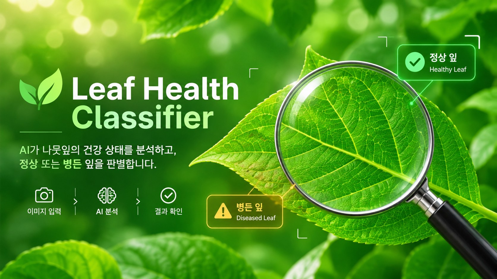
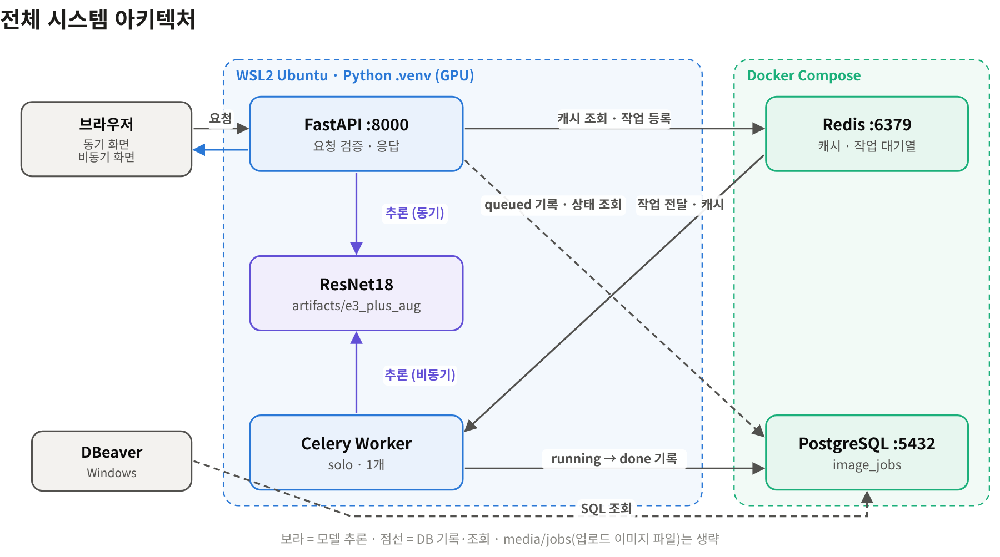
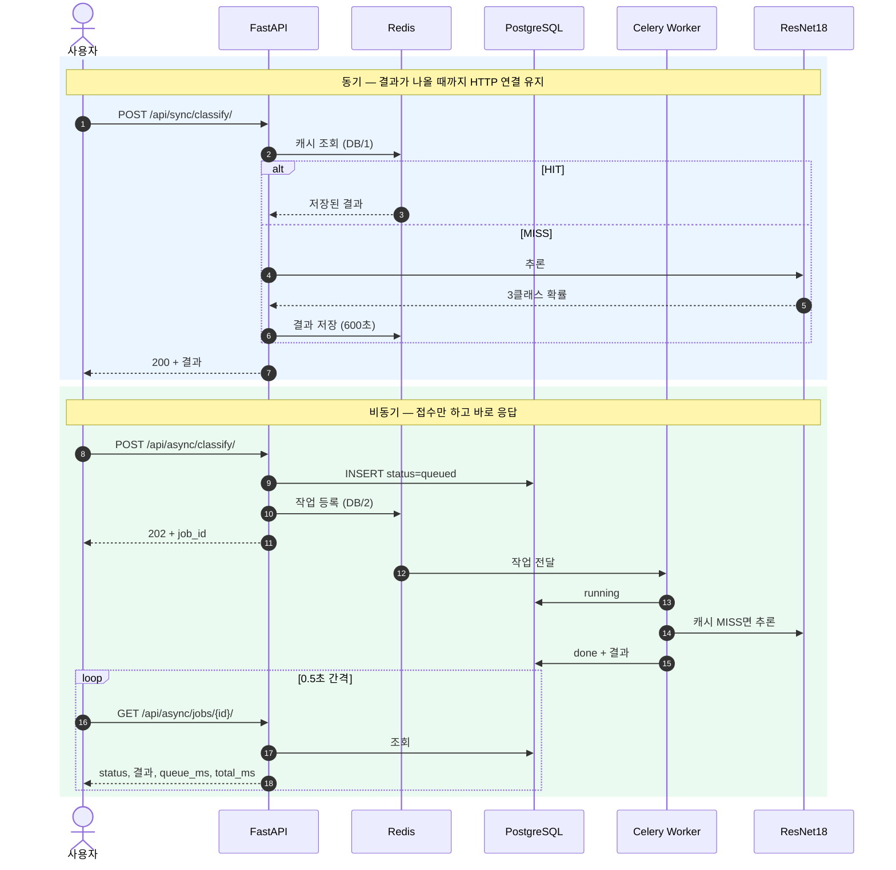
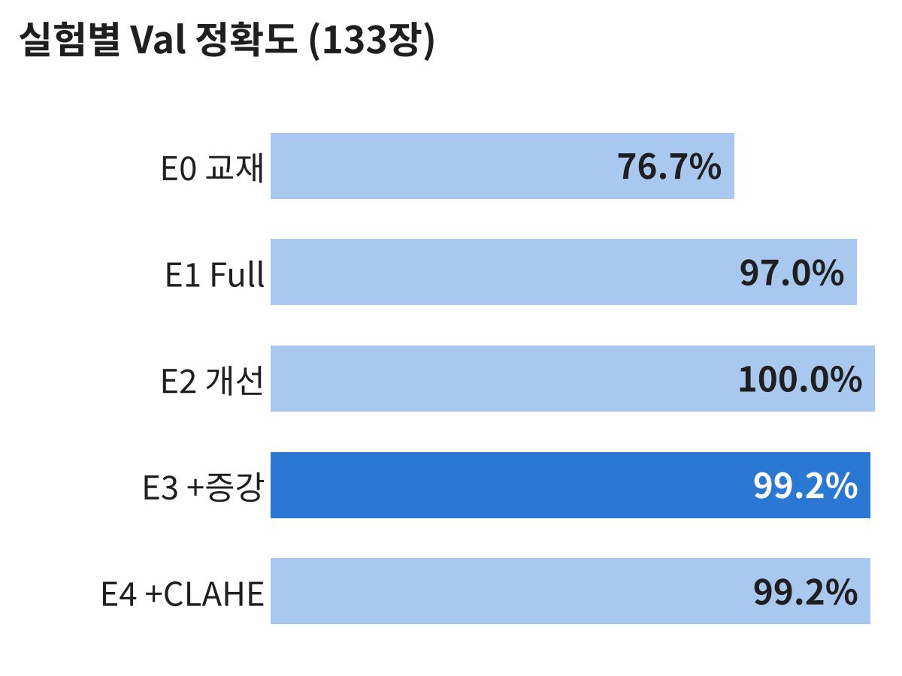
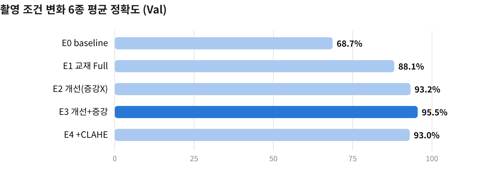
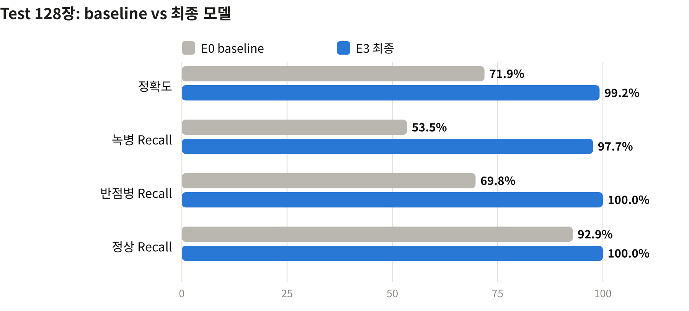
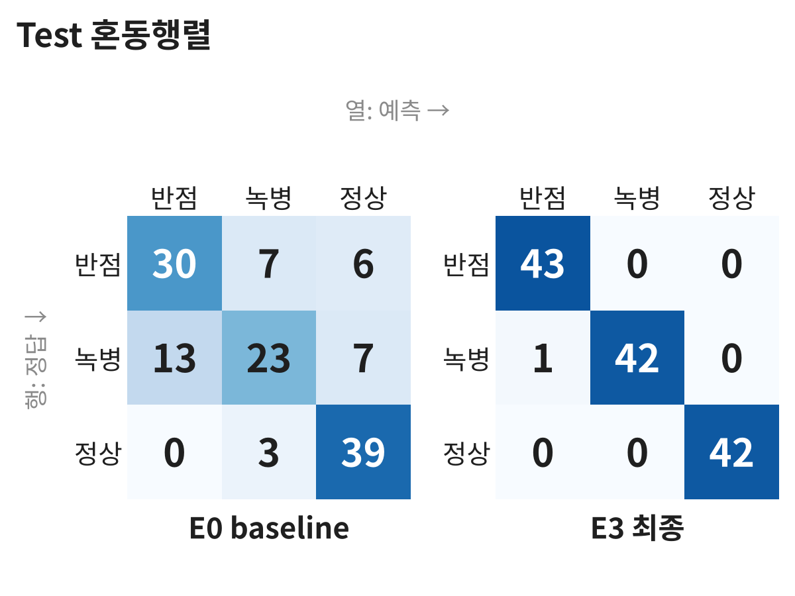
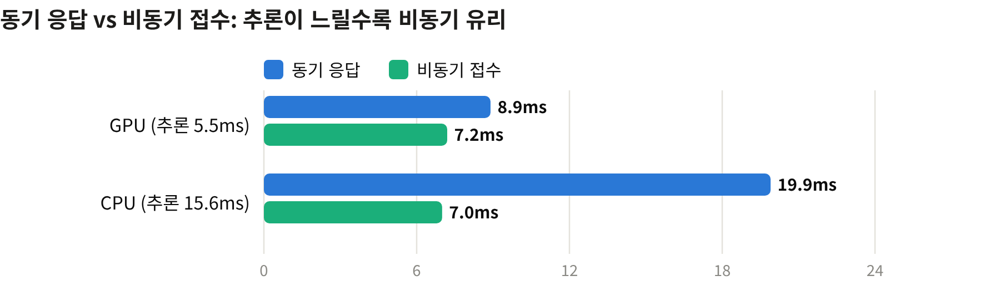
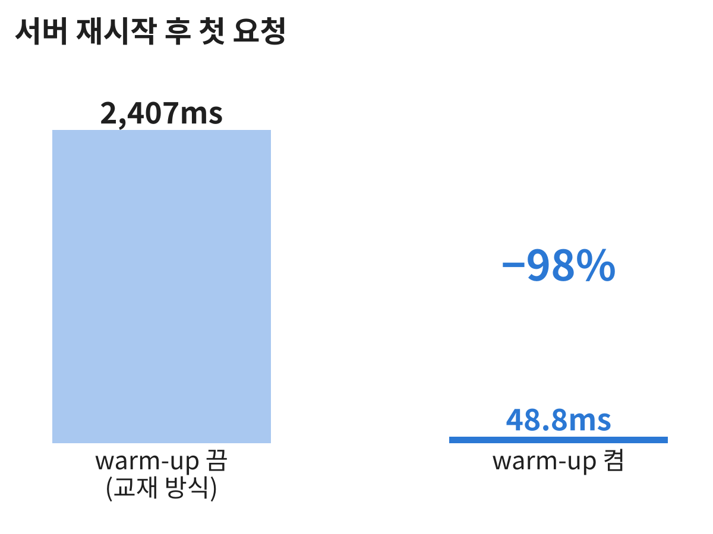

<p align="center">
  
</p>

<h1 align="center">Leaf Health Classifier</h1>

<p align="center">
  <b>콩잎 사진 한 장으로 각진잎반점병 · 녹병 · 정상을 판별하는 Vision AI 웹 서비스</b><br>
  ResNet18 Fine-tuning · FastAPI 동기/비동기 · Redis · Celery · PostgreSQL
</p>

<p align="center">
  
  
  
  
  
  
  
  
</p>

<p align="center">
  <a href="reports/08_최종기술보고서.md"><b>📄 최종 기술보고서</b></a> ·
  <a href="#-전체-아키텍처"><b>🏗 아키텍처</b></a> ·
  <a href="#-모델-결과"><b>📊 모델 결과</b></a> ·
  <a href="#-시스템-성능"><b>⚡ 시스템 성능</b></a> ·
  <a href="#-재실행-안내"><b>▶ 재실행 안내</b></a>
</p>

---

## 📌 개요

교과 9 과제평가(2026.11.04–05) 프로젝트입니다. Hugging Face의 사전학습 모델 `microsoft/resnet-18`(ImageNet 1,000클래스)의 출력층을 3클래스로 바꾸고, 콩잎 데이터셋 [AI-Lab-Makerere/beans](https://huggingface.co/datasets/AI-Lab-Makerere/beans)로 Fine-tuning했습니다. 학습한 모델은 **동기 방식**(요청 → 바로 결과)과 **비동기 방식**(접수 202 → Celery Worker 처리 → 상태 조회) 두 경로의 웹 서비스로 제공합니다.

| 클래스 | 의미 | Train | Val | Test |
|---|---|---:|---:|---:|
| `angular_leaf_spot` | 각진잎반점병 | 345 | 44 | 43 |
| `bean_rust` | 녹병 | 348 | 45 | 43 |
| `healthy` | 정상 | 341 | 44 | 42 |

이 프로젝트는 두 가지 질문에 실측으로 답합니다.

1. **모델**: 교재 기본 설정(Backbone 고정, 3 epoch)은 Test 71.9%에 그칩니다. 무엇을 바꿔야 성능이 오르고, 그 개선이 촬영 조건이 바뀌어도 유지되는가?
2. **시스템**: 동기 방식과 비동기 방식은 실제로 얼마나 다른가? 비동기는 언제 유리하고 언제 불리한가?

## ✨ 핵심 결과

| 영역 | 교재 방식 (baseline) | **이 프로젝트** | 근거 |
|---|---:|---:|---|
| Test 정확도 (128장) | 71.9% | **99.2%** | [산출물 1 §6](reports/01_FineTuning_결과보고서.md) |
| 녹병 Recall | 53.5% | **97.7%** | 〃 |
| 촬영 조건 변화 6종 평균 정확도 | 68.7% | **95.5%** | [산출물 1 §4](reports/01_FineTuning_결과보고서.md) |
| 서버 시작 후 첫 요청 | 2,407ms | **48.8ms** (warm-up) | [산출물 6 §2](reports/06_성능비교_보고서.md) |
| 같은 이미지 재요청 (동기) | 8.9ms | **1.5ms** (Redis 캐시) | [산출물 6 §4](reports/06_성능비교_보고서.md) |
| 비동기 접수 응답 (CPU) | 동기 19.9ms | **7.0ms** (−64.8%) | [산출물 6 §6](reports/06_성능비교_보고서.md) |
| 기능 검증 | – | 모의 5건 + 실환경 18건 **PASS** | [산출물 7](reports/07_기능테스트_오류분석.md) |

- 실험은 **한 번에 하나씩** 바꾸고, 모델 선택 기준(Val → 강건성 → Val Loss)을 **결과를 보기 전에** 정했습니다. Test는 최종 모델을 정한 뒤 1회만 평가했습니다.
- 개선이 안 된 실험도 그대로 기록했습니다: **CLAHE 조명 보정(기각)**, **연결 풀 확대(기각)**.

---

## 🏗 전체 아키텍처

<p align="center">
  
</p>

| 구성 요소 | 실행 위치 | 주요 파일 | 역할 |
|---|---|---|---|
| 브라우저 화면 | Windows 브라우저 | `templates/*.html`, `static/style.css` | 업로드, 확률 막대·한글 병명·처리 시간 표시 |
| FastAPI (:8000) | WSL2 `.venv` | `main.py`, `ai/router_sync.py`, `ai/router_async.py`, `ai/router_web.py` | 요청 검증, 동기 추론, 비동기 접수(202), 상태 조회 |
| ResNet18 모델 | FastAPI·Worker 각 프로세스 | `ai/hf_model.py`, `ai/services.py`, `ai/preprocess.py` | 시작 시 1회 로딩(warm-up), 이미지 검증, 추론 |
| Redis (:6379) | Docker | `ai/cache_service.py`, `ai/celery_app.py` | **DB/1** 결과 캐시(600초) · **DB/2** Celery Broker · **DB/3** Result |
| Celery Worker | WSL2 `.venv` | `ai/tasks.py` | 비동기 추론, `queued → running → done/failed` 갱신 |
| PostgreSQL (:5432) | Docker | `ai/database.py`, `ai/models.py` | `image_jobs` 작업 이력 (생성·시작·완료 시각 포함) |
| DBeaver | Windows | – | `image_jobs` 조회로 DB 기록 확인 |

> **왜 FastAPI·Worker는 Docker 밖(WSL2)에서 실행하나요?** 교재 Docker 이미지는 CPU 전용이라 GPU를 쓸 수 없습니다. 그래서 Docker에는 Redis·PostgreSQL만 두고, 모델을 쓰는 두 프로세스는 GPU가 보이는 WSL2 가상환경에서 실행했습니다.

<details>
<summary><b>요청 처리 흐름 (동기 / 비동기)</b></summary>



</details>

자세한 내용: [시스템 아키텍처](reports/02_시스템_아키텍처.md) · [API 명세](reports/03_API_명세서.md) · [DB 구조](reports/04_DB_구조_작업이력.md) · [버튼 처리 흐름](reports/05_AI버튼_처리흐름.md)

---

## 📊 모델 결과

### 실험 설계 — 한 번에 하나씩

| 실험 | 학습 코드 | 변경 내용 | Val | 강건성 평균 | 판단 |
|---|---|---|---:|---:|---|
| E0 | `finetune.py` (교재) | Head-only, 3 epoch | 76.7% | 68.7% | baseline |
| E1 | `finetune.py` (교재) | 전체 Fine-tuning, lr 5e-5 | 97.0% | 88.1% | Backbone 학습이 가장 큰 개선 |
| E2 | `finetune_plus.py` | 2단계 학습 · 차등 학습률 · 코사인 스케줄 · label smoothing · 조기 종료 | 100% | 93.2% | Train 100% → 외우기 시작 |
| **E3** | `finetune_plus.py` | E2 + 데이터 증강 (색조 제외) | 99.2% | **95.5%** | **최종 선택** |
| E4 | `finetune_plus.py` | E3 + CLAHE 조명 보정 | 99.2% | 93.0% | 가설 기각 |

<p align="center">
  
  
</p>

**Val만으로는 고를 수 없었던 이유**: Val 133장에서 E2–E4의 차이가 1장 이내였습니다. 그래서 Val 이미지에 학습 때보다 강한 변화(어둡게 ×0.5, 밝게 ×1.6, 대비 ×0.5, 흐림, 45° 회전, JPEG 품질 20)를 주는 **강건성 평가**를 추가했고, 이 기준에서 E3가 가장 잘 버텼습니다. 특히 "밝게" 조건에서 E2 80.5% → E3 89.5%로 증강 효과가 드러났습니다.

### Test 평가 (최종 모델 확정 후 1회)

| Test 128장 | E0 baseline | **E3 최종** |
|---|---:|---:|
| 정확도 | 71.88% | **99.22%** |
| Macro F1 | 0.7109 | **0.9922** |
| 녹병 Recall | 0.5349 | **0.9767** |
| 오분류 | 36장 | **1장** |

<p align="center">
  
  
</p>

유일한 오분류(`bean_rust_test.15.jpg`, 녹병 → 반점병, 확신도 0.60)는 baseline도 똑같이 틀린 어려운 샘플입니다. 상세: [산출물 1 Fine-tuning 결과보고서](reports/01_FineTuning_결과보고서.md)

---

## ⚡ 시스템 성능

`scripts/benchmark.py`로 같은 조건(같은 모델, 캐시 비우고 MISS/HIT 쌍, 동시 요청은 `threading.Barrier`로 동시 출발, 중앙값)에서 측정했습니다.

| 측정 (중앙값) | GPU | CPU |
|---|---:|---:|
| 동기 응답 (MISS) | 8.9ms | 19.9ms |
| 비동기 접수 응답 (MISS) | 7.2ms | 7.0ms |
| 비동기 최종 결과 확인 (MISS) | 30.2ms | 55.3ms |
| 동기 응답 (캐시 HIT) | 1.5ms | 1.9ms |

<p align="center">
  
  
</p>

**결론**

- **비동기 접수 시간은 추론 시간과 무관하게 약 7ms**입니다. 동기는 추론 시간만큼 늘어나므로, 추론이 느린 CPU에서 비동기 접수가 64.8% 빨랐고 GPU에서는 19.1%였습니다.
- **최종 결과는 비동기가 항상 더 늦습니다**(큐 대기 + DB 기록 + 상태 조회). 비동기는 결과를 빨리 주는 기술이 아니라 **서버가 추론 동안 붙잡히지 않게 하는 기술**입니다.
- 동시 20건에서는 현재 구성(서버 1 프로세스, Worker 1개)상 동기가 더 빨랐습니다. 연결 풀 확대로 개선을 시도했지만 오히려 느려져 **가설을 기각**했습니다.
- 서버 시작 시 모델을 미리 로딩(warm-up)해 첫 요청 지연을 2,407ms → 48.8ms로 줄였습니다.

상세: [산출물 6 성능비교 보고서](reports/06_성능비교_보고서.md)

---

## 🔀 교재 방식과 다르게 한 것

| 영역 | 교재 | 이 프로젝트 | 효과 |
|---|---|---|---|
| 학습 | Head-only 3 epoch | 2단계 학습 + 차등 학습률 + 스케줄 + 증강 (`finetune_plus.py`) | Test 71.9% → 99.2% |
| 평가 | Val 정확도만 | 강건성 평가 · Test 1회 평가 · 클래스별 지표 · 혼동행렬 (`evaluate.py`) | Val 포화 상태에서도 모델 비교 가능 |
| 모델 선택 | – | 기준을 결과 보기 전에 선언 | 결과에 맞춘 선택 방지 |
| 실행 위치 | FastAPI·Worker도 Docker | Docker는 Redis·PostgreSQL만, 나머지는 WSL2 | GPU 사용 |
| 모델 로딩 | 첫 요청 때 | 서버·Worker 시작 시 (warm-up) | 첫 요청 −98% |
| DB 기록 | 상태·결과 | `started_at`, `finished_at` 추가 | 큐 대기·처리 시간을 서버 기준으로 측정 |
| 전처리 | 없음 | 모델 폴더의 `preprocess.json`을 서빙에서도 적용 | 학습·서빙 전처리 불일치 방지 |
| 성능 측정 | 브라우저 수동 | 측정 스크립트 + GPU/CPU 분리 + 동시 요청 | 반복 가능한 비교 |

---

## ▶ 재실행 안내

### 1. 환경

| 항목 | 사용한 값 |
|---|---|
| OS | Windows + WSL2 Ubuntu 26.04.1 |
| Python | 3.12 (가상환경 `.venv`) |
| GPU | NVIDIA RTX 3060 12GB (없으면 CPU로 자동 실행) |
| Docker | Docker Desktop / Docker Compose — Redis `6379`, PostgreSQL `5432` |
| Python 프로세스 | FastAPI(Uvicorn), Celery Worker — WSL2에서 실행 |

```bash
git clone https://github.com/simpson92/leaf-health-classifier.git
cd leaf-health-classifier
uv venv --python 3.12          # 또는 python3.12 -m venv .venv
source .venv/bin/activate
uv pip install -r requirements.txt   # 또는 pip install -r requirements.txt
```

### 2. 데이터 준비

원본은 `~/beans_source`에 보존하고, 코드 실행용 `dataset/`으로 복사합니다. 원본의 `validation`은 코드가 읽는 이름인 `val`로 배치됩니다.

```bash
mkdir -p ~/beans_source && cd ~/beans_source
for s in train validation test; do
  wget -q "https://huggingface.co/datasets/AI-Lab-Makerere/beans/resolve/main/data/$s.zip"
  unzip -q -o "$s.zip" -d "$s"
done
cd -   # 프로젝트 루트로 돌아오기 (반드시 루트에서 실행)

python -m training.check_data --source ~/beans_source --dataset dataset
```

`check_data`는 `train → train`, `validation → val`, `test → test`로 복사하고(`train/train`처럼 중첩돼도 처리), 클래스별 개수·중복·Split 간 누출·손상 파일을 점검합니다. 기대값: Train 1,034 / Val 133 / Test 128, 중복·누출·손상 0건.

### 3. 모델 준비

```bash
# E0 baseline (교재 명령 그대로)
python -m training.finetune --data dataset --output artifacts/beans_resnet18 --epochs 3 --batch-size 8 --freeze-backbone

# E3 최종 모델 (기본값: 2단계 학습 + 데이터 증강, 최대 15 epoch)
python -m training.finetune_plus --output artifacts/e3_plus_aug

# 평가: Val 강건성 → (최종 모델 확정 후) Test 1회
python -m training.evaluate --model artifacts/e3_plus_aug --split val --robustness
python -m training.evaluate --model artifacts/e3_plus_aug --split test
```

<details>
<summary>나머지 비교 실험 (E1, E2, E4)</summary>

```bash
python -m training.finetune --data dataset --output artifacts/beans_resnet18_full --epochs 3 --batch-size 8 --lr 0.00005
python -m training.finetune_plus --output artifacts/e2_plus_noaug --augment none
python -m training.finetune_plus --output artifacts/e4_plus_aug_clahe --preprocess clahe
```

</details>

모델 연결:

```bash
cp .env.example .env
# .env 에서  MODEL_PATH=artifacts/e3_plus_aug  로 변경
```

### 4. 구동 순서 (터미널 3개)

```bash
# 터미널 1 — Redis·PostgreSQL
source .venv/bin/activate
docker compose up -d
docker compose exec redis redis-cli ping                          # PONG
docker compose exec postgres pg_isready -U vision_user -d vision_db  # accepting connections

# 터미널 2 — Celery Worker (계속 실행 상태로 둠)
source .venv/bin/activate
celery -A ai.celery_app:celery_app worker --loglevel=info --pool=solo --concurrency=1

# 터미널 3 — FastAPI
source .venv/bin/activate
python -m uvicorn main:app --reload
```

| 화면 | 주소 |
|---|---|
| 동기 분류 | http://127.0.0.1:8000/vision/sync/ |
| 비동기 분류 | http://127.0.0.1:8000/vision/async/ |
| API 문서 (Swagger) | http://127.0.0.1:8000/docs |

### 5. 확인할 응답

```bash
curl http://127.0.0.1:8000/health
# {"status":"ok"}

IMG=$(ls dataset/test/bean_rust/*.jpg | head -1)
curl -F "image=@$IMG" http://127.0.0.1:8000/api/sync/classify/
# 200: model_id, top1, all, inference_ms, cache_hit  (같은 이미지를 다시 보내면 cache_hit=true, inference_ms=null)

curl -i -F "image=@$IMG" http://127.0.0.1:8000/api/async/classify/
# 202: job_id, status=queued, check_url
curl http://127.0.0.1:8000/api/async/jobs/<job_id>/
# 200: status=done, top1, all, queue_ms, total_ms

docker compose exec postgres psql -U vision_user -d vision_db \
  -c "SELECT id, status, top1_label, top1_score, cache_hit, created_at, finished_at FROM image_jobs ORDER BY id DESC LIMIT 5;"
```

| 경우 | 응답 |
|---|---|
| 이미지가 아닌 파일 | 400 |
| 5MB 초과 | 413 |
| 없는 `job_id` | 404 |
| Redis 중지 상태에서 비동기 접수 | 503 + DB `failed` 기록 |

DBeaver 접속 정보: Host `127.0.0.1` · Port `5432` · DB `vision_db` · User `vision_user` · Password `vision_pass` (로컬 교육용 값)

테스트와 성능 측정:

```bash
python -m pytest -q          # 모의 테스트 5건 (실제 모델·Redis·DB 없이 실행)
python -m scripts.benchmark  # 서버·Worker 실행 상태에서. 결과: reports/data/timings.csv, timings_summary.md
```

### 6. 결과물 위치

```text
leaf-health-classifier/
├── ai/                     # FastAPI 라우터, 모델 로딩·추론, 캐시, Celery, DB 모델
├── training/
│   ├── check_data.py       # 데이터 배치·점검
│   ├── finetune.py         # 교재 원본 학습 코드 (E0, E1)
│   ├── finetune_plus.py    # 개선 학습 코드 (E2–E4)
│   └── evaluate.py         # Val/Test 평가, 강건성 평가
├── scripts/benchmark.py    # 동기·비동기 성능 측정
├── templates/, static/     # 동기·비동기 화면
├── tests/test_api.py       # 모의 테스트
├── main.py                 # FastAPI 진입점 (시작 시 DB 초기화 + warm-up)
├── compose.yaml            # Redis + PostgreSQL
├── requirements.txt, .env.example
├── assets/banner.jpg
└── reports/
    ├── 01_FineTuning_결과보고서.md
    ├── 02_시스템_아키텍처.md
    ├── 03_API_명세서.md
    ├── 04_DB_구조_작업이력.md
    ├── 05_AI버튼_처리흐름.md
    ├── 06_성능비교_보고서.md
    ├── 07_기능테스트_오류분석.md
    ├── 08_최종기술보고서.md
    ├── data/               # 측정 원본 CSV, 모델별 학습·평가 JSON
    ├── evidence/           # 실행 캡처
    └── figures/            # 아키텍처·그래프
```

| 산출물 | 문서 |
|---|---|
| 1 | [Fine-tuning 결과보고서](reports/01_FineTuning_결과보고서.md) |
| 2 | [시스템 아키텍처](reports/02_시스템_아키텍처.md) |
| 3 | [API 명세서](reports/03_API_명세서.md) |
| 4 | [DB 구조·작업이력](reports/04_DB_구조_작업이력.md) |
| 5 | [AI 버튼 처리흐름](reports/05_AI버튼_처리흐름.md) |
| 6 | [성능비교 보고서](reports/06_성능비교_보고서.md) |
| 7 | [기능테스트·오류분석](reports/07_기능테스트_오류분석.md) |
| 8 | [최종 기술보고서](reports/08_최종기술보고서.md) + 이 README |

학습 결과 원본은 로컬 `artifacts/<모델>/training_report.json`, `history.csv`, `eval_*.json`에 생성되며, 같은 파일을 [`reports/data/models/`](reports/data/models/)에 복사해 두었습니다.

### 7. 제출 및 보안

GitHub에 올리지 않은 것과 다시 만드는 방법:

| 제외 항목 | 이유 | 확보 방법 |
|---|---|---|
| `.env` | 로컬 설정 | `cp .env.example .env` 후 `MODEL_PATH` 수정 |
| `dataset/` | 대용량 원본 데이터 | 2단계 명령으로 Hugging Face에서 다운로드 |
| `artifacts/` (모델 가중치, 43MB) | 대용량 생성 파일 | 3단계 명령으로 재학습 (seed 42) 또는 별도 제출 경로로 전달 |
| `media/jobs/` | 업로드된 이미지 | 서비스 실행 시 자동 생성 |

- 비밀번호·API 키는 저장소에 없습니다. `compose.yaml`과 `ai/config.py`의 DB 계정은 **로컬 교육용 기본값**이며 포트는 `127.0.0.1`에만 열립니다.
- 라이선스: 모델 `microsoft/resnet-18` — Apache-2.0, 데이터셋 `AI-Lab-Makerere/beans` — MIT (각 저장소 표기 기준)

---

## ⚠ 한계

- **데이터 규모**: Val 133장, Test 128장이라 1장이 약 0.8%p입니다. 작은 차이는 구분하기 어렵습니다.
- **재현 변동**: 학습은 seed 42로 1회씩, 동시 요청 측정도 조건별 1회입니다.
- **강건성 평가**는 인공적인 변형이며, 실제 다른 현장에서 찍은 사진이 아닙니다.
- **데이터 출처**가 한 지역(우간다)이라 다른 환경의 콩잎 성능은 알 수 없습니다.
- **향후 과제**: 확신도 기반 "확인 필요" 판정(유일한 Test 오분류의 확신도 60.5%), `uvicorn --workers N`·Worker 수 확장 실험, Grad-CAM으로 판단 근거 확인.

## 📚 참고 문헌

| 연구 | 이 프로젝트와의 관계 |
|---|---|
| Mohanty, S. P., Hughes, D. P., & Salathé, M. (2016). Using Deep Learning for Image-Based Plant Disease Detection. *Frontiers in Plant Science*, 7, 1419. | 통제된 촬영 조건 데이터의 한계 → 강건성 평가의 동기 |
| Image based anthracnose and red-rust leaf disease detection using deep learning. *TELKOMNIKA* (2022). — 망고 잎, ResNet18/34/50/101 비교 | ResNet18이 잎 질병 분류에 충분하다는 근거 |
| Dhawan et al. (2023). *ELCVIA*. — 망고 잎 약 2,000장, ResNet18 전이학습 | 비슷한 규모 데이터에서의 ResNet18 전이학습 |
| Wani et al. (2025). *Annals of Data Science*. — 사과 잎 4클래스, 전이학습 + 이미지 향상 | 전처리·증강을 통한 성능 개선 |
| *IIETA* — 토마토 잎, ResNet18/50/101 + 데이터 증강 | 증강 효과 검증 |
| Development of an AI Web Based System for Classification of Tomatoes Disease (2025). | 웹 서비스 배포 후 응답시간·처리량 측정 항목 참고 |

- 데이터셋: [AI-Lab-Makerere/beans](https://huggingface.co/datasets/AI-Lab-Makerere/beans) · 모델: [microsoft/resnet-18](https://huggingface.co/microsoft/resnet-18)
- 참고 구현: [SimpleITAutomation/async-ml-inference](https://github.com/SimpleITAutomation/async-ml-inference) (FastAPI + Celery 비동기 ML 추론 PoC)
