# 산출물 1. ResNet18 콩잎 3클래스 Fine-tuning 결과보고서

- 평가 대상: 콩잎(Beans) 이미지 3클래스 분류 (`angular_leaf_spot` 각진잎반점병 / `bean_rust` 녹병 / `healthy` 정상)
- 기준 모델: `microsoft/resnet-18` (Hugging Face, Apache-2.0)
- baseline: 교재 제공 `training/finetune.py`, Head-only → `artifacts/beans_resnet18/`
- **최종 서비스 모델**: 개선 학습 `training/finetune_plus.py` (2단계 학습 + 데이터 증강) → `artifacts/e3_plus_aug/`
- 결과 요약: **Test 정확도 71.9% → 99.2%**, 녹병 Recall 53.5% → 97.7%
- 원본 기록: [`data/models/`](data/models/) (모델별 `training_report.json`, `history.csv`, `eval_*.json`)

> 모델 경로 관련: 교재는 학습 결과 경로를 `artifacts/beans_resnet18`로 통일하도록 안내한다. 이 프로젝트는 baseline과 개선 모델을 비교해야 하므로 실험별로 폴더를 분리했다. baseline은 `artifacts/beans_resnet18`, 최종 서비스 모델은 `artifacts/e3_plus_aug`이며 `.env`의 `MODEL_PATH`도 `artifacts/e3_plus_aug`로 설정했다.

---

## 1. 데이터 구성

`python -m training.check_data --source ~/beans_source --dataset dataset` 실행 결과 ([`data/data_check.json`](data/data_check.json), 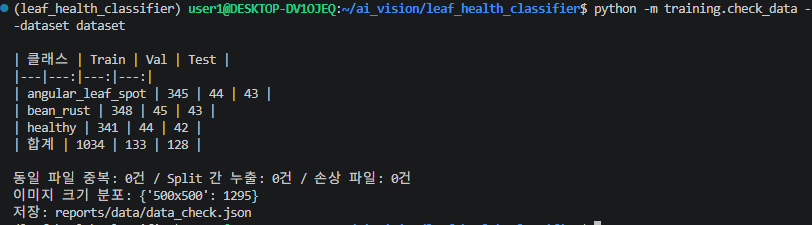)

| 클래스 | Train | Val | Test |
|---|---:|---:|---:|
| angular_leaf_spot | 345 | 44 | 43 |
| bean_rust | 348 | 45 | 43 |
| healthy | 341 | 44 | 42 |
| **합계** | **1,034** | **133** | **128** |

| 점검 항목 | 결과 | 방법 |
|---|---|---|
| 원본 → 코드 폴더 매핑 | `train→train`, `validation→val`, `test→test` | `check_data.py`가 복사 (원본 `~/beans_source` 보존) |
| 동일 파일 중복 | 0건 | 전체 1,295장 SHA-256 해시 비교 |
| Split 간 누출 | 0건 | 같은 해시가 서로 다른 Split에 있는지 확인 |
| 손상 파일 | 0건 | `PIL.Image.verify()` |
| 이미지 크기 | 1,295장 모두 500×500 | |

- 클래스 비율이 거의 1:1:1이라 클래스 가중치 보정은 적용하지 않았다.
- `test`는 학습·모델 선택에 사용하지 않았고, 최종 모델 확정 후 1회만 평가했다.

## 2. 실험 설계: 한 번에 하나씩 바꾸기

| 실험 | 학습 코드 | 학습 방식 | 주요 설정 | 저장 폴더 |
|---|---|---|---|---|
| **E0** baseline | `finetune.py` (교재 원본) | **Head-only** (Backbone 고정) | 3 epoch, batch 8, lr 2e-4 | `beans_resnet18` |
| E1 | `finetune.py` (교재 원본) | Full Fine-tuning | 3 epoch, batch 8, lr 5e-5 | `beans_resnet18_full` |
| E2 | `finetune_plus.py` | 2단계 (Head 2 epoch → 전체) | 최대 15 epoch, 증강 없음 | `e2_plus_noaug` |
| **E3** 최종 | `finetune_plus.py` | 2단계 | E2 + **데이터 증강** | `e3_plus_aug` |
| E4 | `finetune_plus.py` | 2단계 | E3 + **CLAHE 조명 보정** | `e4_plus_aug_clahe` |

**`finetune_plus.py`의 개선 내용 (E2~E4 공통)**

| 개선 | 설정 | 목적 |
|---|---|---|
| 2단계 학습 | 1~2 epoch 분류 헤드만 → 3 epoch부터 전체 | 무작위로 초기화된 새 헤드가 사전학습 가중치를 망가뜨리는 것을 방지 |
| 차등 학습률 | 헤드 1e-3 / Backbone 1e-4 | 새 층은 빠르게, 사전학습 층은 조금만 수정 |
| Warmup + 코사인 스케줄 | 1 epoch warmup 후 코사인 감소 | 학습 초반 불안정과 후반 진동 완화 |
| Label smoothing | 0.1 | 과도한 확신(과적합) 완화 |
| 조기 종료 | Val 개선 없이 5 epoch이면 중단 | 불필요한 학습 방지 |
| Best 저장 기준 | Val 정확도, 같으면 Val Loss가 낮은 epoch | |
| 공통 | AdamW, weight decay 1e-4, batch 32, seed 42, GPU AMP | |

**데이터 증강 (E3·E4, 학습 데이터에만 적용)**: RandomResizedCrop(256, scale 0.6~1.0), 좌우·상하 반전, 회전 ±20°, 밝기·대비 ±20%. **색조(hue)는 변경하지 않았다.** 병반의 노란색·갈색이 질병을 구분하는 핵심 단서이기 때문이다.

**CLAHE (E4)**: Lab 색공간에서 밝기(L) 채널에만 CLAHE(clipLimit 2.0, 8×8)를 적용하고 색(a, b)은 유지. 교과 9 머신비전의 "조명에 강한 색 판별" 아이디어를 적용했다. 학습과 서빙이 같은 전처리를 쓰도록 모델 폴더에 `preprocess.json`을 저장하고 `ai/services.py`가 이를 읽는다.

## 3. 학습 결과

### 3-1. baseline E0 (Head-only) — 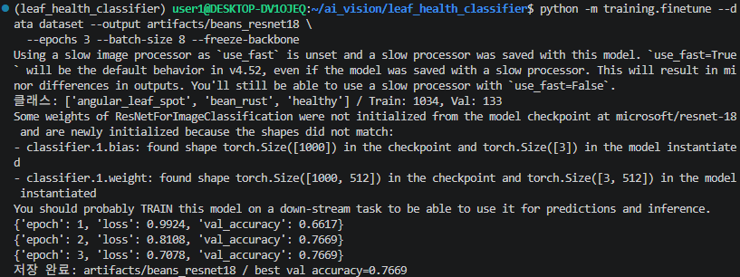

| Epoch | Train Loss | Val Accuracy |
|---:|---:|---:|
| 1 | 0.9924 | 0.6617 |
| 2 | 0.8108 | **0.7669** |
| 3 | 0.7078 | 0.7669 |

### 3-2. E1 (교재 코드 Full Fine-tuning) — 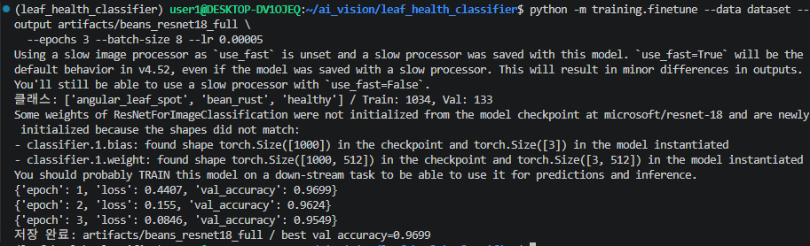

| Epoch | Train Loss | Val Accuracy |
|---:|---:|---:|
| 1 | 0.4407 | **0.9699** |
| 2 | 0.1550 | 0.9624 |
| 3 | 0.0846 | 0.9549 |

Train Loss는 계속 줄지만 Val 정확도는 1 epoch 이후 떨어진다. Val 차이가 1~2장이라 단정할 수는 없지만, 과적합의 신호로 보았다.

### 3-3. E3 (최종 모델) — 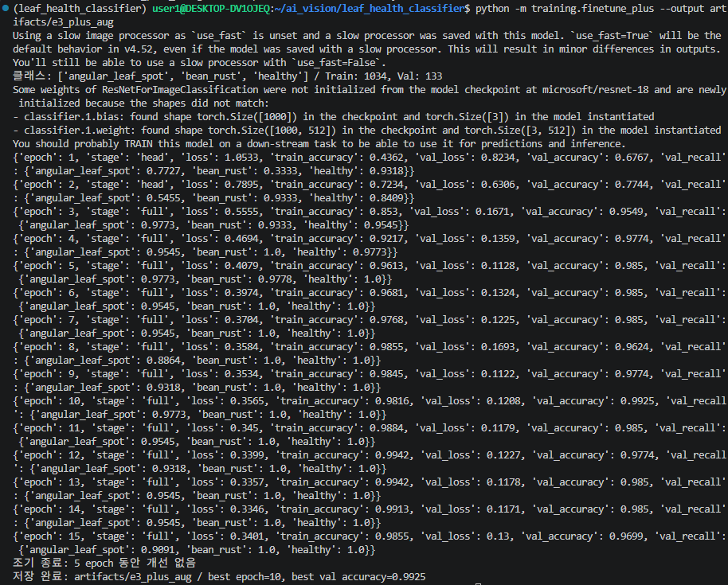, 원본 [`history.csv`](data/models/e3_plus_aug/history.csv)

| Epoch | 단계 | Train Loss | Train Acc | Val Loss | Val Acc | 녹병 Recall |
|---:|---|---:|---:|---:|---:|---:|
| 1 | head | 1.0533 | 0.4362 | 0.8234 | 0.6767 | 0.3333 |
| 2 | head | 0.7895 | 0.7234 | 0.6306 | 0.7744 | 0.9333 |
| 3 | full | 0.5555 | 0.8530 | 0.1671 | 0.9549 | 0.9333 |
| 5 | full | 0.4079 | 0.9613 | 0.1128 | 0.9850 | 0.9778 |
| **10** | full | 0.3565 | 0.9816 | 0.1208 | **0.9925** | 1.0000 |
| 15 | full | 0.3401 | 0.9855 | 0.1300 | 0.9699 | 1.0000 |

- Best epoch 10에서 저장, 최대 15 epoch까지 학습 (epoch 11~15 개선 없음). 학습 시간 40.5초 (RTX 3060).
- Head 단계(1~2 epoch)는 baseline과 비슷한 수준(77%)이고, Backbone을 푸는 3 epoch부터 95%로 뛴다. **콩잎 병반을 구분하려면 사전학습 특징을 그대로 쓰는 것으로는 부족하고 Backbone까지 조정해야 한다**는 것을 보여준다.

### 3-4. 실험 전체 비교 (Val 133장)

학습 로그: 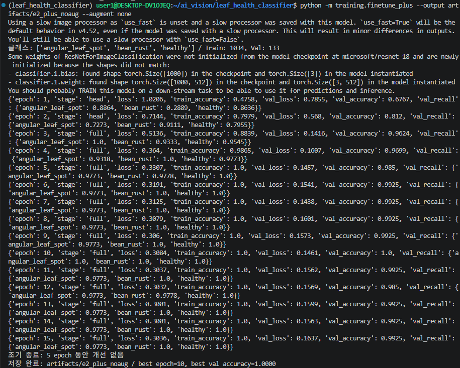 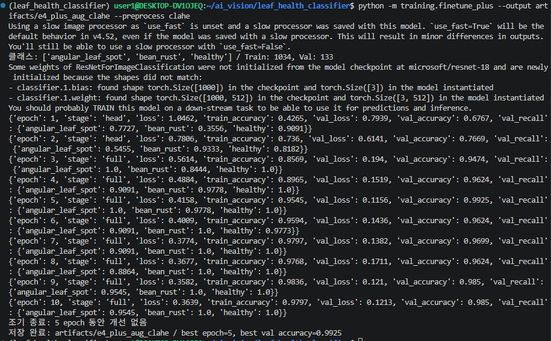 · baseline Val 평가: 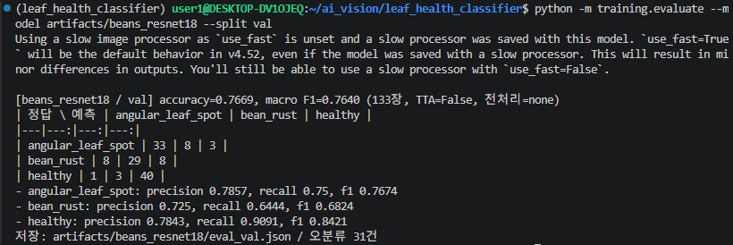

| 실험 | Best Val 정확도 | Best epoch | Best 시점 Val Loss | 마지막 Train 정확도 |
|---|---:|---:|---:|---:|
| E0 baseline | 0.7669 | 2 | - | - |
| E1 교재 Full | 0.9699 | 1 | - | - |
| E2 개선(증강 X) | **1.0000** | 10 | 0.1461 | 1.0000 |
| E3 개선+증강 | 0.9925 | 10 | 0.1208 | 0.9855 |
| E4 +CLAHE | 0.9925 | 5 | **0.1156** | 0.9797 |

- E0/E1은 교재 코드라 Val Loss를 기록하지 않는다.
- E2는 5 epoch부터 Train 정확도 100%로 학습 데이터를 외우기 시작했다. 증강을 넣은 E3·E4는 Train이 100%에 도달하지 않고 Val Loss가 더 낮다.
- **E2~E4의 Val 정확도 차이는 최대 1장(0.75%p)** 이라 Val 정확도만으로는 우열을 가릴 수 없다. 그래서 아래 강건성 평가를 추가했다.

## 4. 강건성 평가 (Val 이미지에 촬영 조건 변화 적용)

`python -m training.evaluate --model artifacts/<모델> --split val --robustness` ([`training/evaluate.py`](../training/evaluate.py), 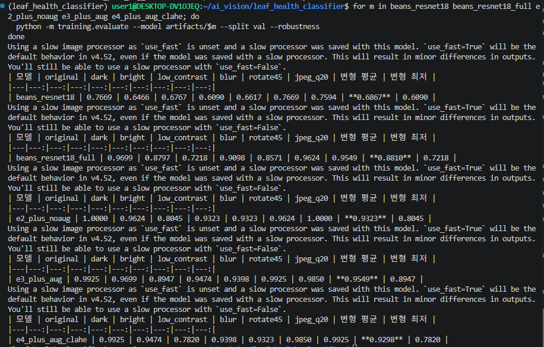)

학습 증강보다 **더 강한** 변화를 줘서, 학습 때 보지 못한 촬영 조건에서도 버티는지 측정했다. 어둡게(밝기 ×0.5), 밝게(×1.6), 대비 낮춤(×0.5), 흐림(Gaussian r=3), 45° 회전, JPEG 품질 20. Test는 사용하지 않았다.

| 모델 | 원본 | 어둡게 | 밝게 | 대비↓ | 흐림 | 회전45 | JPEG | **변형 평균** | 변형 최저 |
|---|---:|---:|---:|---:|---:|---:|---:|---:|---:|
| E0 baseline | 76.7 | 64.7 | 67.7 | 60.9 | 66.2 | 76.7 | 75.9 | 68.7 | 60.9 |
| E1 교재 Full | 97.0 | 88.0 | 72.2 | 91.0 | 85.7 | 96.2 | 95.5 | 88.1 | 72.2 |
| E2 개선(증강 X) | 100.0 | 96.2 | 80.5 | 93.2 | 93.2 | 96.2 | 100.0 | 93.2 | 80.5 |
| **E3 개선+증강** | 99.2 | **97.0** | **89.5** | **94.7** | **94.0** | **99.2** | 98.5 | **95.5** | **89.5** |
| E4 +CLAHE | 99.2 | 94.7 | 78.2 | 94.0 | 93.2 | 98.5 | 99.2 | 93.0 | 78.2 |

(단위: %, 원본 JSON: `data/models/*/eval_val_robustness.json`)

**발견**
1. **증강의 효과는 원본 Val에서는 보이지 않았지만 강건성 평가에서 드러났다.** E2→E3에서 "밝게" 80.5%→89.5%(+9.0%p), 변형 평균 93.2%→95.5%(+2.3%p).
2. **CLAHE 가설은 기각되었다.** 조명 보정이 조명 변화에 강하게 만들 것으로 예상했지만, E4는 "밝게"에서 78.2%로 E3보다 11.3%p 낮았다. 이미 밝은 사진의 국소 대비를 더 키우면서 병반과 반사광의 구분이 흐려진 것으로 추정한다(원인은 미검증).
3. baseline은 변형 조건에서 60%대까지 떨어진다. 최종 모델은 같은 조건 평균에서 +26.8%p 더 버틴다.

## 5. 최종 모델 선택

**결과를 보기 전에 정한 기준**: ① Val 정확도 (1장 이내 차이는 동률) → ② 강건성 변형 평균 → ③ Val Loss

| 기준 | E2 | E3 | E4 | 판정 |
|---|---:|---:|---:|---|
| ① Val 정확도 | 100.0% | 99.2% | 99.2% | 1장 차이 → 동률 |
| ② 변형 평균 | 93.2% | **95.5%** | 93.0% | **E3** |

→ **최종 모델: E3 (`artifacts/e3_plus_aug`)**

## 6. Test 평가 (최종 모델 확정 후 1회)

`python -m training.evaluate --model artifacts/<모델> --split test` (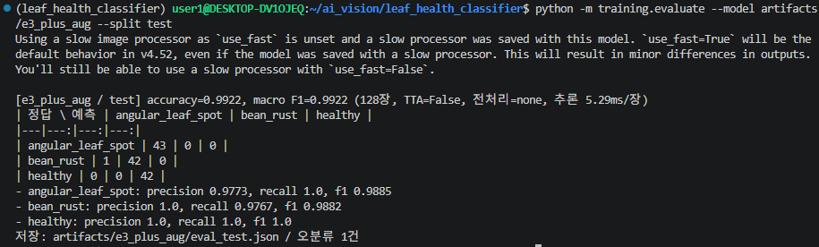, 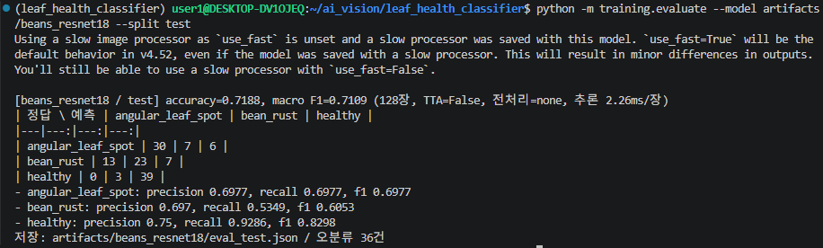)

| Test 128장 | E0 baseline | **E3 최종** | 변화 |
|---|---:|---:|---:|
| 정확도 | 71.88% | **99.22%** | +27.34%p |
| Macro F1 | 0.7109 | **0.9922** | +0.2813 |
| 반점병 Recall | 0.6977 | 1.0000 | +0.3023 |
| **녹병 Recall** | 0.5349 | **0.9767** | +0.4418 |
| 정상 Recall | 0.9286 | 1.0000 | +0.0714 |
| 오분류 | 36장 | **1장** | |

**혼동행렬 (행: 정답, 열: 예측)**

| E0 baseline | 반점병 | 녹병 | 정상 |
|---|---:|---:|---:|
| 반점병 | 30 | 7 | 6 |
| 녹병 | 13 | 23 | 7 |
| 정상 | 0 | 3 | 39 |

| E3 최종 | 반점병 | 녹병 | 정상 |
|---|---:|---:|---:|
| 반점병 | 43 | 0 | 0 |
| 녹병 | 1 | 42 | 0 |
| 정상 | 0 | 0 | 42 |

- E3의 유일한 오분류 `bean_rust_test.15.jpg`(녹병 → 반점병, 확신도 0.60)는 **baseline도 똑같이 반점병으로 틀린** 이미지다. 두 병의 반점 모양이 비슷한 어려운 샘플로 보인다.
- Test 정확도(99.2%)가 Val(99.2%)과 같은 수준이라, Val에 과하게 맞춘 결과가 아님을 보여준다.
- Test는 E0와 E3만 평가했다. E1·E2·E4의 Test 성능은 **미측정**이다.

## 7. 생성 파일 확인 — 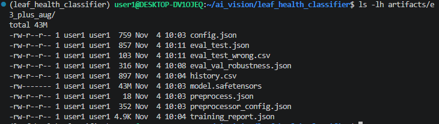

`artifacts/e3_plus_aug/`

- [x] `config.json` (3클래스 `id2label`)
- [x] `model.safetensors` (43MB, 저장소에는 미포함)
- [x] `preprocessor_config.json` (ConvNextImageProcessor, ImageNet mean/std)
- [x] `preprocess.json` (`{"method": "none"}`)
- [x] `training_report.json`, `history.csv`
- [x] `eval_val_robustness.json`, `eval_test.json`, `eval_test_wrong.csv`

## 8. 서비스 연결 확인

**학습 전후 비교 (같은 이미지 `healthy_test.0.jpg`)**

| 모델 | 1위 예측 | 2위 예측 | 증빙 |
|---|---|---|---|
| 학습 전 `microsoft/resnet-18` (ImageNet 1,000클래스) | bonnet, poke bonnet (모자) 70.3% | head cabbage (양배추) 17.2% | 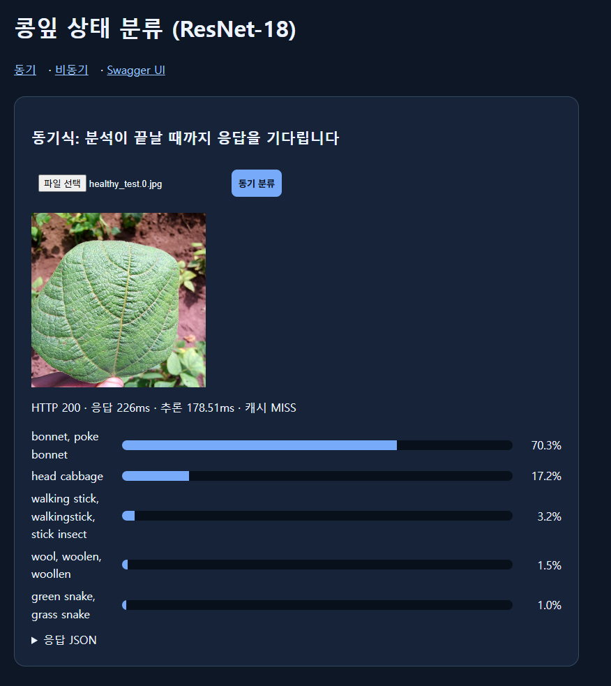 |
| 학습 후 `artifacts/e3_plus_aug` | **정상 91.4%** | 각진잎반점병 4.8% | 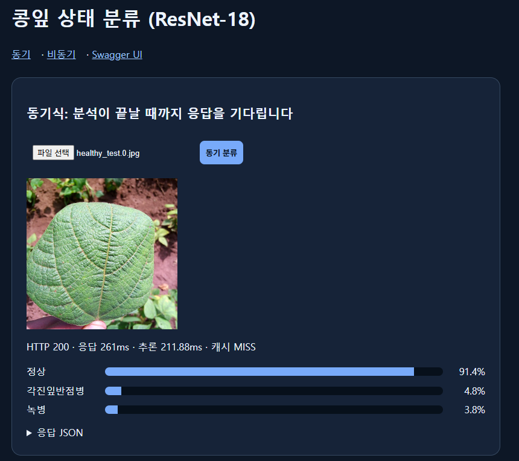 |

원본 모델은 콩잎 질병이라는 개념 자체를 모르기 때문에, 사진을 일반 사물 이름으로만 분류한다. Fine-tuning으로 출력층을 3클래스로 바꾸고 학습해야 서비스에 쓸 수 있다.

**클래스별 확인**

| 이미지 | 예측 | 확신도 | 증빙 |
|---|---|---:|---|
| `healthy_test.0.jpg` | 정상 | 91.4% | 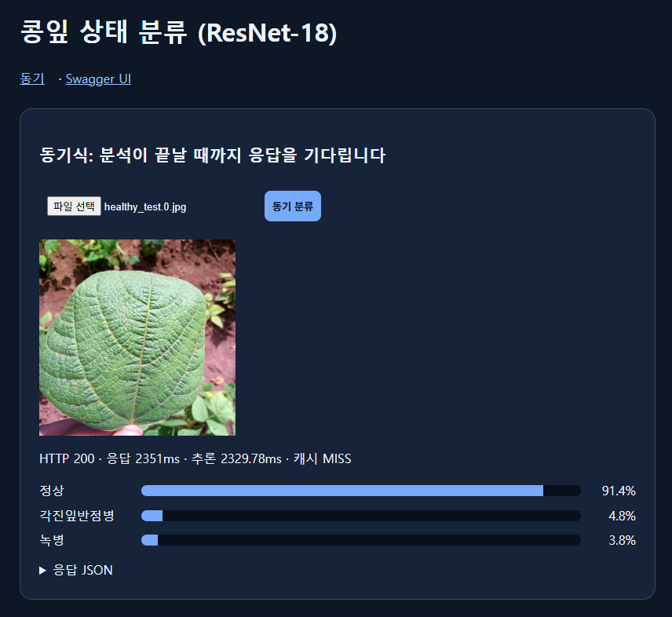 |
| `bean_rust_test.0.jpg` | 녹병 | 92.5% | 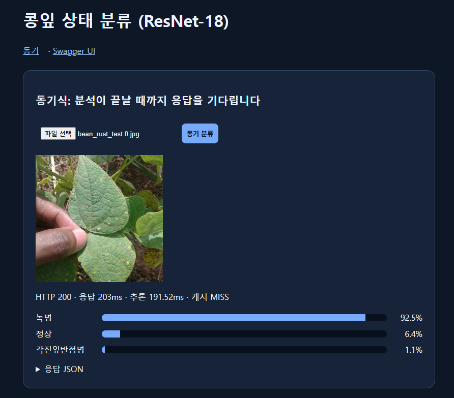 |
| `angular_leaf_spot_test.0.jpg` | 각진잎반점병 | 81.8% | 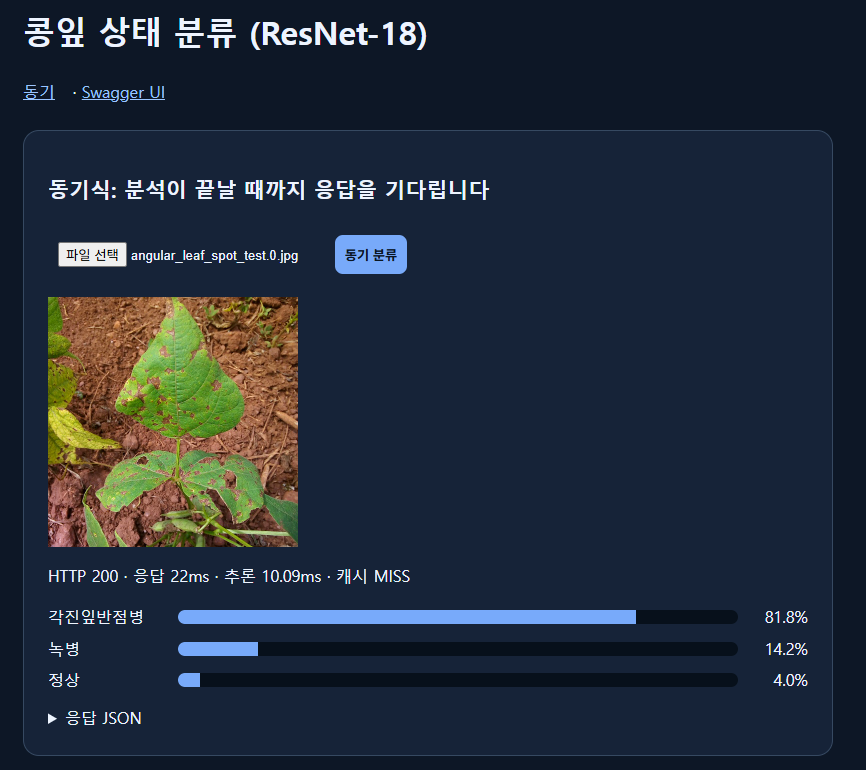 |

## 9. 결과 판정과 한계

- **완료**: baseline(Head-only) 학습, 개선 학습 4종 비교, 강건성 평가, 최종 모델 Test 평가, 서비스 연결
- **한계**
  - Val 133장, Test 128장으로 1장이 약 0.8%p라 작은 차이는 통계적으로 구분이 어렵다.
  - 모든 실험은 seed 42 한 번씩만 실행했다. 시드에 따른 변동은 측정하지 않았다.
  - 강건성 평가는 실제 현장 사진이 아닌 인공적인 변형이다.
  - Beans 데이터는 한 지역(우간다) 사진이라 다른 환경의 콩잎에 대한 성능은 알 수 없다.
