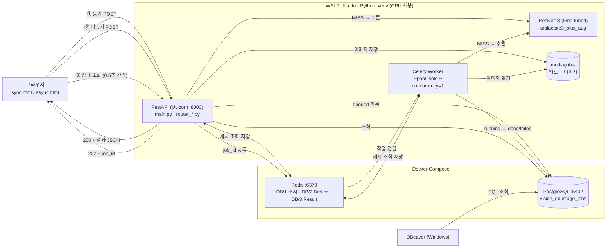
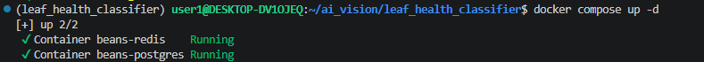
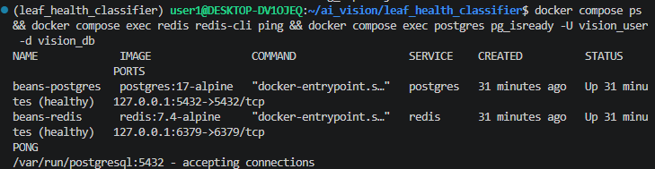
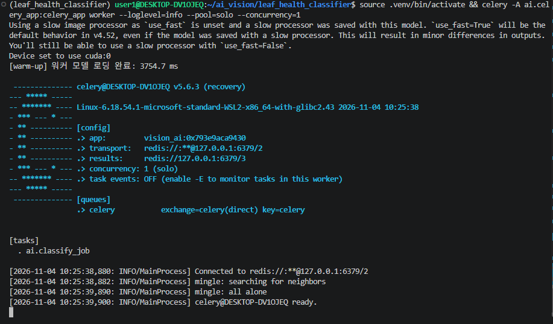
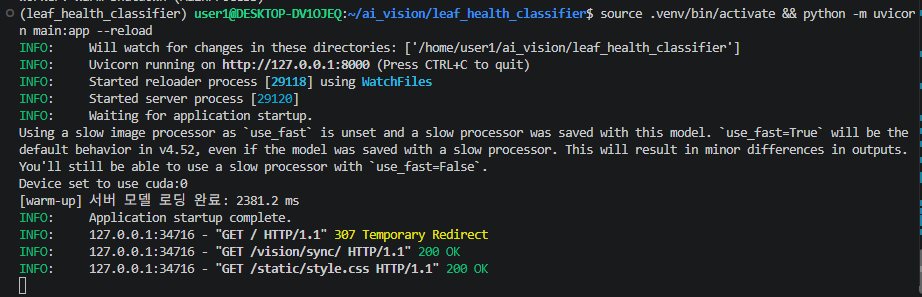

# 산출물 2. 전체 시스템 아키텍처

## 1. 구성도

## 2. 구성 요소별 역할

| 구성 요소 | 실행 위치 | 파일 / 서비스 | 역할 |
|---|---|---|---|
| 브라우저 화면 | Windows 브라우저 | `templates/sync.html`, `async.html`, `base.html`, `static/style.css` | 이미지 업로드, 결과·확률 막대·시간 표시 |
| FastAPI | WSL2 `.venv` | `main.py`, `ai/router_sync.py`, `ai/router_async.py`, `ai/router_web.py` | HTTP 요청 검증·응답, 작업 접수, 상태 조회 |
| 설정 | WSL2 | `ai/config.py`, `.env` | 모델 경로, DB·Redis 주소, 업로드 제한, warm-up |
| 모델 로딩·추론 | FastAPI·Worker 각 프로세스 | `ai/hf_model.py`, `ai/services.py`, `ai/preprocess.py` | 프로세스당 1회 로딩, 이미지 검증, 전처리, 추론 |
| Redis 캐시 | Docker Redis **DB/1** | `ai/cache_service.py` | 같은 이미지·같은 모델이면 결과 재사용 (TTL 600초) |
| Redis Broker | Docker Redis **DB/2** | `ai/celery_app.py` | FastAPI → Worker 작업 전달 |
| Redis Result | Docker Redis **DB/3** | `ai/celery_app.py` | Celery 작업 상태 (화면 조회는 PostgreSQL 사용) |
| Celery Worker | WSL2 `.venv` 별도 터미널 | `ai/tasks.py` | 비동기 추론, DB 상태 갱신 |
| PostgreSQL | Docker | `ai/database.py`, `ai/models.py` | `image_jobs` 작업 이력 영구 저장 |
| 업로드 이미지 | WSL2 디스크 | `media/jobs/<uuid>.bin` | Worker가 읽을 원본 (DB에는 경로만 저장) |
| 학습·평가 | WSL2 `.venv` | `training/*.py`, `scripts/benchmark.py` | 모델 학습, 평가, 성능 측정 |
| DBeaver | Windows | - | PostgreSQL 내용 확인 |

## 3. 실행 환경 ([`data/env.txt`](data/env.txt))

| 항목 | 값 |
|---|---|
| OS | Windows + WSL2 Ubuntu 26.04.1 LTS (커널 6.18.54.1-microsoft-standard-WSL2) |
| CPU / RAM | Intel Core i7-12700 / 15GiB |
| GPU | NVIDIA GeForce RTX 3060 12GB |
| Python | 3.12.16 |
| 주요 라이브러리 | torch 2.15.0+cu132, transformers 4.57.6, fastapi 0.162.0, celery 5.6.3, sqlalchemy 2.1.7 |
| Docker | Docker Desktop 29.9.2 (`redis:7.4-alpine`, `postgres:17-alpine`) |
| 모델 경로 | `MODEL_PATH=artifacts/e3_plus_aug` |

## 4. 교재 02와 다르게 설계한 부분

| 항목 | 교재 02 | 이 프로젝트 | 이유 |
|---|---|---|---|
| FastAPI·Celery 위치 | Docker 컨테이너 (`web`, `worker`) | **WSL2 가상환경** | 교재 Docker 이미지는 CPU 전용이라 GPU를 쓸 수 없음. 평가가이드 그림(Docker에는 Redis·PostgreSQL만)과 일치 |
| 모델 로딩 시점 | 첫 요청 때 로딩 | **서버·워커 시작 시 미리 로딩(warm-up)** | 첫 요청 지연 2,407ms → 48.8ms ([산출물 6](06_성능비교_보고서.md)) |
| 모델 경로 | 실행 위치 기준 상대경로 | 프로젝트 기준 절대경로로 변환 (`resolve_model_path`) | 다른 폴더에서 실행해도 모델을 찾도록 |
| 추론 장치 | CPU 고정 (`device=-1`) | GPU 있으면 자동 사용 | |
| 처리 시간 기록 | 없음 | `image_jobs.started_at`, `finished_at` 추가 | 큐 대기·접수→완료 시간을 서버 기준으로 측정 |
| 전처리 | 없음 | 모델 폴더의 `preprocess.json`을 서빙에서도 적용 | 학습·서빙 전처리 불일치 방지 |

## 5. 구조 검증 결과

- **동기**: 브라우저 → FastAPI → Redis 캐시(MISS) → ResNet18 → FastAPI → 브라우저 (HTTP 200). 동기 요청은 `image_jobs`에 저장하지 않는다.
- **비동기**: 브라우저 → FastAPI → `media/jobs` 저장 → PostgreSQL(`queued`) → Redis Broker → Worker(`running`) → 캐시/ResNet18 → PostgreSQL(`done`) → 브라우저 상태 조회
- 모델은 FastAPI와 Worker **두 프로세스에 각각 로딩**된다(warm-up 로그 각각 확인). GPU 메모리 사용이 2배가 되는 대신, 동기 경로와 비동기 경로가 서로 영향을 주지 않는다.

| 증빙 | 파일 |
|---|---|
| Docker 서비스 실행 |   |
| Worker 시작·warm-up |  |
| 서버 시작·warm-up |  |
