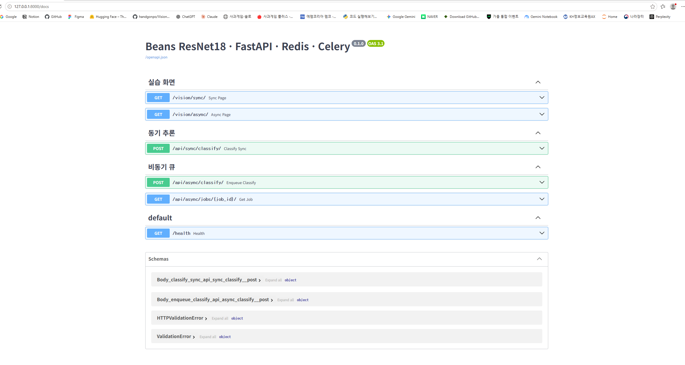
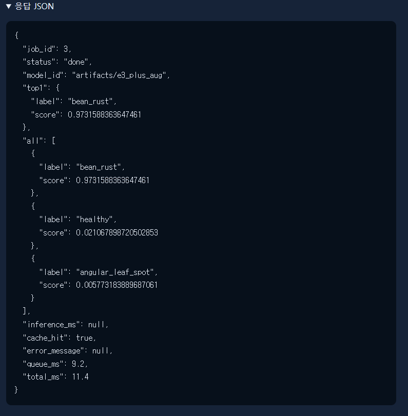
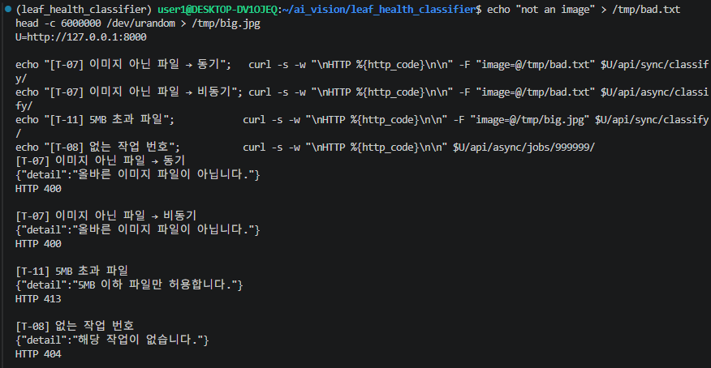
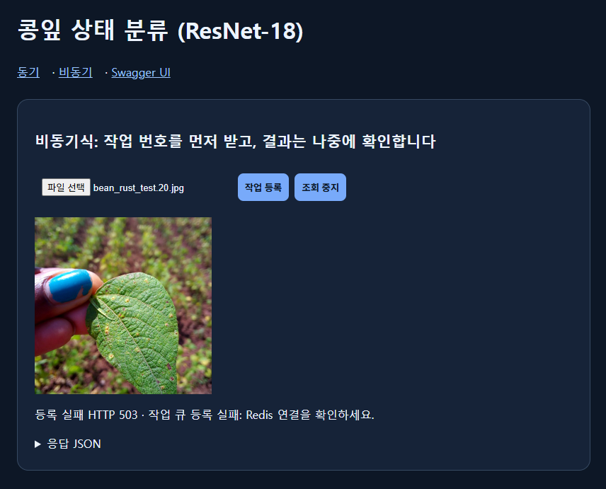
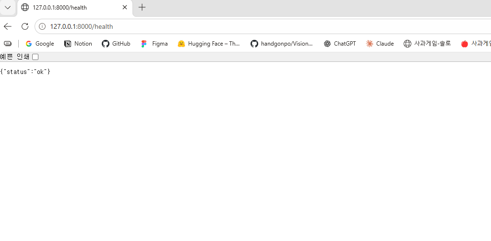
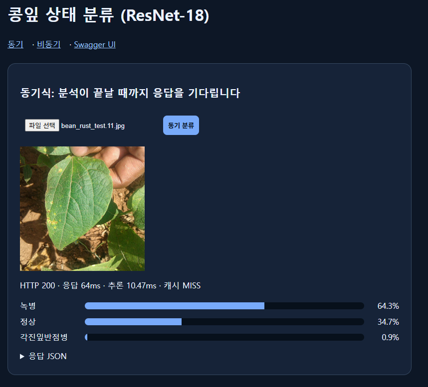
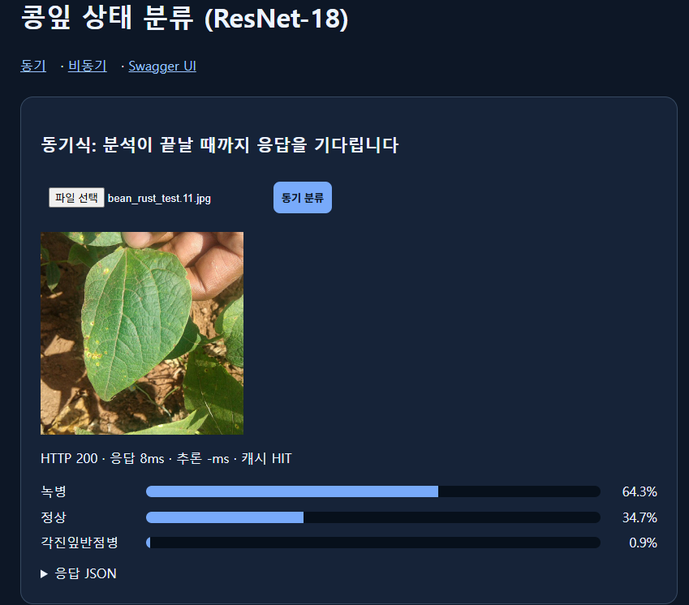
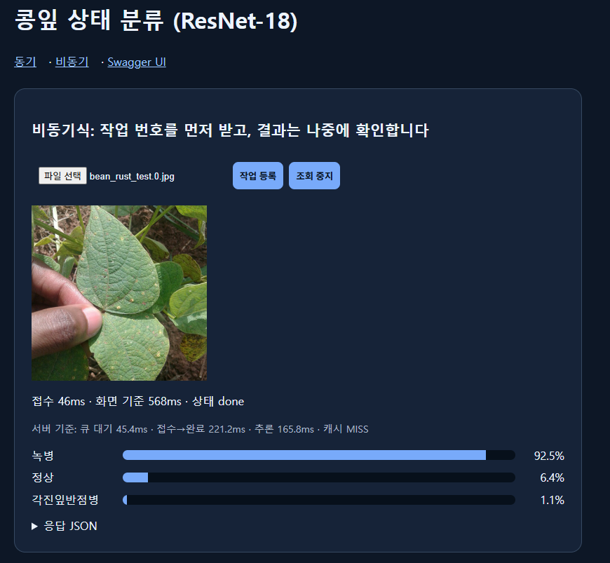

# 산출물 3. API 명세서

- Base URL: `http://127.0.0.1:8000`
- 자동 문서: `GET /docs` (Swagger UI) — 

## 1. API 목록

| API ID | Method | URL | 요청 | 성공 | 주요 응답 | 실패 |
|---|---|---|---|---:|---|---|
| API-01 | GET | `/health` | 없음 | 200 | `status` | 서버 미실행 시 응답 없음 |
| API-02 | POST | `/api/sync/classify/` | `multipart/form-data`, 필드 `image` | 200 | `model_id`, `top1`, `all`, `inference_ms`, `cache_hit` | 400, 413, 422 |
| API-03 | POST | `/api/async/classify/` | `multipart/form-data`, 필드 `image` | **202** | `job_id`, `status`, `check_url` | 400, 413, 422, 503 |
| API-04 | GET | `/api/async/jobs/{job_id}/` | 경로 정수 `job_id` | 200 | `status`, `top1`, `all`, `inference_ms`, `cache_hit`, `error_message`, `queue_ms`, `total_ms` | 404, 422 |
| WEB-00 | GET | `/` | 없음 | 307 | `/vision/sync/`로 이동 | - |
| WEB-01 | GET | `/vision/sync/` | 없음 | 200 | 동기 분류 HTML | - |
| WEB-02 | GET | `/vision/async/` | 없음 | 200 | 비동기 분류 HTML | - |

`queue_ms`, `total_ms`는 교재에 없는 **추가 필드**다. 기존 필드 이름(`all` 등)은 교재와 같게 유지했다.

## 2. 입력 검증 규칙 (`ai/services.py` → `load_rgb_image`)

| 규칙 | 위반 시 |
|---|---|
| 파일 크기 1바이트 이상, 5MB 이하 | 5MB 초과는 **413**, 0바이트는 400 |
| JPEG / PNG / WEBP 형식 | 400 "JPG, PNG, WEBP 이미지만 허용합니다." |
| 해상도 1,200만 픽셀 이하 | 400 "이미지 해상도가 너무 큽니다(최대 1200만 픽셀)." |
| 이미지로 디코딩 가능 | 400 "올바른 이미지 파일이 아닙니다." |
| `image` 필드 누락 | 422 (FastAPI 자동 검증) |

비동기 API는 **큐에 등록하기 전에** 같은 검증을 한다. 잘못된 파일은 DB에 기록되지 않는다.

## 3. API 상세

### API-02 동기 분류

| 항목 | 내용 |
|---|---|
| 처리 | 캐시 확인 → MISS면 추론 → 결과 캐시 저장 → 응답 (추론이 끝날 때까지 HTTP 응답 대기) |
| 성공 | 200 OK |
| 오류 | 400 잘못된 이미지 / 413 크기 초과 |

성공 응답 (MISS, `bean_rust_test.0.jpg` 실측. top1 점수는 DB 기록값, 나머지 두 점수는 화면 표시 %를 옮긴 값)

```json
{
  "model_id": "artifacts/e3_plus_aug",
  "top1": {"label": "bean_rust", "score": 0.9249},
  "all": [
    {"label": "bean_rust", "score": 0.9249},
    {"label": "healthy", "score": 0.0640},
    {"label": "angular_leaf_spot", "score": 0.0110}
  ],
  "inference_ms": 191.52,
  "cache_hit": false
}
```

같은 이미지를 다시 보내면 `"cache_hit": true`, `"inference_ms": null`. **`null`은 추론을 생략했다는 뜻이지 0ms가 아니다.**

### API-03 비동기 작업 접수

| 항목 | 내용 |
|---|---|
| 처리 | 이미지 검증 → `media/jobs/<uuid>.bin` 저장 → `image_jobs`에 `queued` 기록 → Celery 큐 등록 → 즉시 응답 |
| 성공 | **202 Accepted** (작업 접수일 뿐 분석 완료가 아님) |
| 오류 | 400 / 413 / **503** 큐 등록 실패 (Redis 장애. 이때 DB 행은 `failed`로 기록) |

```json
{"job_id": 3, "status": "queued", "check_url": "/api/async/jobs/3/"}
```

### API-04 작업 상태 조회

| `status` | 의미 | `top1`, `all` |
|---|---|---|
| `queued` | 접수됨, Worker 대기 중 | `null` |
| `running` | Worker가 처리 중 | `null` |
| `done` | 완료 | 값 있음 |
| `failed` | 실패 (`error_message`에 원인) | `null` |

`done` 응답 (job 3, 캐시 HIT 실측) — 

```json
{
  "job_id": 3,
  "status": "done",
  "model_id": "artifacts/e3_plus_aug",
  "top1": {"label": "bean_rust", "score": 0.9731588363647461},
  "all": [
    {"label": "bean_rust", "score": 0.9731588363647461},
    {"label": "healthy", "score": 0.021067898720502853},
    {"label": "angular_leaf_spot", "score": 0.005773183889687061}
  ],
  "inference_ms": null,
  "cache_hit": true,
  "error_message": null,
  "queue_ms": 9.2,
  "total_ms": 11.4
}
```

| 추가 필드 | 계산 | 의미 |
|---|---|---|
| `queue_ms` | `started_at − created_at` | 큐에서 Worker를 기다린 시간 |
| `total_ms` | `finished_at − created_at` | 서버 기준 접수→완료 시간 (브라우저 폴링 간격과 무관) |

## 4. 오류 응답 (실측)

| 상황 | HTTP | 응답 본문 | 증빙 |
|---|---:|---|---|
| 이미지가 아닌 파일 (동기·비동기) | 400 | `{"detail":"올바른 이미지 파일이 아닙니다."}` |  |
| 5MB 초과 | 413 | `{"detail":"5MB 이하 파일만 허용합니다."}` | 같은 캡처 |
| 없는 작업 번호 | 404 | `{"detail":"해당 작업이 없습니다."}` | 같은 캡처 |
| Redis 중지 상태에서 비동기 접수 | 503 | `{"detail":"작업 큐 등록 실패: Redis 연결을 확인하세요."}` |  |

## 5. 실행 근거

| 검증 ID | 입력 | 실제 결과 | 증빙 |
|---|---|---:|---|
| API-01-T01 | `GET /health` | 200 `{"status":"ok"}` |  |
| API-02-T01 | `bean_rust_test.11.jpg` (처음) | 200, MISS, 64ms |  |
| API-02-T02 | 같은 파일 다시 | 200, HIT, 8ms |  |
| API-03-T01 | `bean_rust_test.0.jpg` | 202, job 1 |  |
| API-04-T01 | job 3 조회 | 200, `done` |  |
| API-04-T02 | job 999999 조회 | 404 |  |
