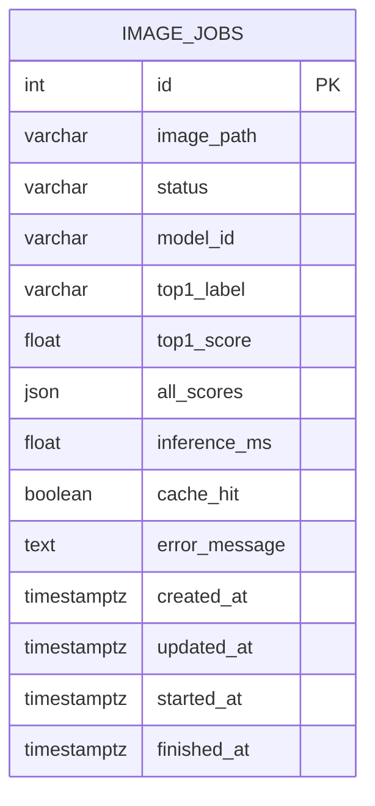
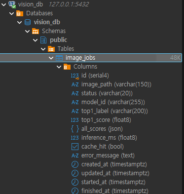
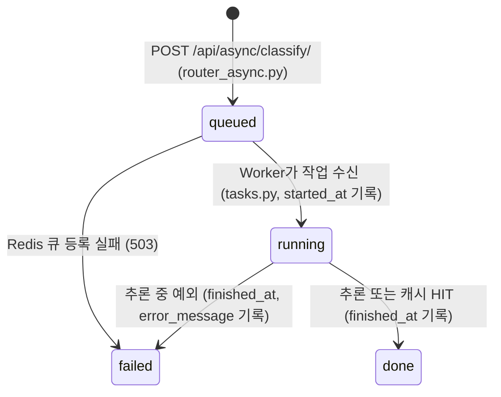
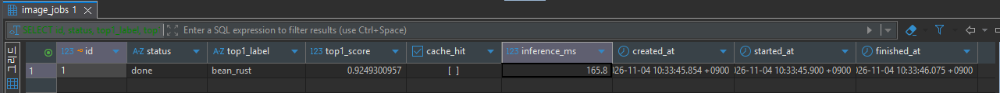
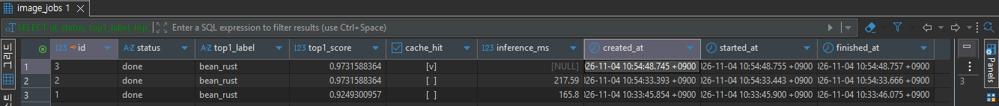
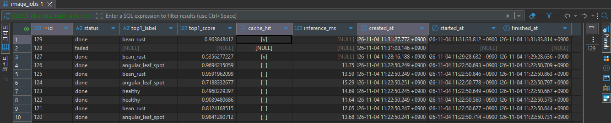
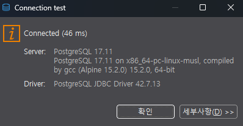

# 산출물 4. 데이터베이스 구조 및 작업 이력

- DB: PostgreSQL 17 (Docker `beans-postgres`, `127.0.0.1:5432`, DB `vision_db`)
- 테이블: `public.image_jobs` 1개 (외래키·관계 테이블 없음)
- 저장 대상: **비동기 작업**의 상태와 결과. 동기 요청은 저장하지 않는다.
- 정의 파일: `ai/models.py` (SQLAlchemy ORM), 생성: 서버 시작 시 `ai/database.py`의 `init_db()` → `create_all()`

## 1. 테이블 구조





| 컬럼 | 자료형 | Null / 기본값 | 예시 | 저장 이유 |
|---|---|---|---|---|
| `id` | serial4 (PK) | 자동 증가 | 129 | 작업 번호 (`job_id`) |
| `image_path` | varchar(150) | NOT NULL | `9f2c...e1.bin` | `media/jobs/` 안의 파일 이름. 사용자가 보낸 파일명은 쓰지 않음(경로 조작 방지) |
| `status` | varchar(20), index | NOT NULL, 기본 `queued` | `done` | 처리 상태. 조회가 잦아 인덱스 |
| `model_id` | varchar(255) | NOT NULL, 기본 `''` | `artifacts/e3_plus_aug` | 어떤 모델이 판정했는지 추적 |
| `top1_label` | varchar(200) | NULL | `bean_rust` | 최종 분류 |
| `top1_score` | float8 | NULL | 0.9638 | 최종 분류 확신도 |
| `all_scores` | json | NULL | `[{"label":"bean_rust","score":0.96},...]` | 3클래스 전체 확률 |
| `inference_ms` | float8 | NULL | 217.59 | 실제 추론 시간. **캐시 HIT면 NULL**(추론 생략) |
| `cache_hit` | bool | NULL | false | Redis 캐시 재사용 여부 |
| `error_message` | text | NULL | `작업 큐 등록 실패: ...` | 실패 원인 |
| `created_at` | timestamptz | NOT NULL, 접수 시각 | | 접수 시점 |
| `updated_at` | timestamptz | NOT NULL, 수정 시 갱신 | | 마지막 변경 시점 |
| `started_at` | timestamptz | NULL | | **[추가]** Worker가 작업을 시작한 시각 |
| `finished_at` | timestamptz | NULL | | **[추가]** 완료·실패 시각 |

- 이미지 원본은 DB에 넣지 않고 `media/jobs/<uuid>.bin` 파일로 저장한다. DB는 가볍게 유지하고 경로만 기록한다.
- `started_at`, `finished_at`은 교재에 없는 컬럼이다. 이 두 값으로 **큐 대기 시간**(`started_at − created_at`)과 **서버 기준 접수→완료 시간**(`finished_at − created_at`)을 계산해 API-04 응답(`queue_ms`, `total_ms`)과 [산출물 6](06_성능비교_보고서.md)에 사용했다.

## 2. 상태 변화



`failed`라도 **`started_at`이 비어 있으면 접수 단계 실패**(큐 등록 실패), **값이 있으면 Worker 실행 중 실패**로 구분할 수 있다.

## 3. 조회 SQL (DBeaver)

```sql
SELECT id, status, top1_label, top1_score, cache_hit, inference_ms,
       created_at, started_at, finished_at
FROM public.image_jobs
ORDER BY id DESC
LIMIT 10;
```

## 4. 실제 작업 이력

### 4-1. 정상 처리와 캐시 —  

| id | status | top1_label | top1_score | cache_hit | inference_ms | 판정 |
|---:|---|---|---:|---|---:|---|
| 1 | done | bean_rust | 0.9249 | false | 165.8 | 비동기 첫 추론 (MISS) |
| 2 | done | bean_rust | 0.9732 | false | 217.59 | 새 이미지 추론 (MISS) |
| 3 | done | bean_rust | 0.9732 | **true** | NULL | id 2와 같은 이미지 → 캐시 재사용 |

### 4-2. 장애 상황 — 

| id | status | cache_hit | created_at | started_at | finished_at | 상황 |
|---:|---|---|---|---|---|---|
| 127 | done | true | 11:28:16.188 | 11:29:28.632 | 11:29:28.636 | **Worker 중지 중 접수** → 72초 대기 후 Worker 재시작 시 처리 |
| 128 | **failed** | NULL | 11:31:08.146 | NULL | NULL | **Redis 중지 중 접수** → 큐 등록 실패(503) |
| 129 | done | true | 11:31:27.772 | 11:31:33.812 | 11:31:33.814 | Redis 재시작 직후 접수 → **큐 대기 6.0초** (Worker 재연결 시간) |

- id 4~126은 성능 측정 스크립트(`scripts/benchmark.py`)가 3회 실행되며 만든 작업이다(회당 41건).
- id 128처럼 Redis 장애로 실패한 작업도 기록이 남아, 사용자가 상태를 조회하면 원인을 알 수 있다.

## 5. 점검

- [x] 테이블 1개, 실제 없는 외래키·관계 테이블 없음
- [x] `done` / `failed` 행 모두 실제 관찰
- [x] 캐시 MISS(`inference_ms` 값 있음)와 HIT(`NULL`) 행 비교
- [x] 동기 요청은 DB에 저장되지 않음 (교재 설계와 동일)
- 연결 정보: 
