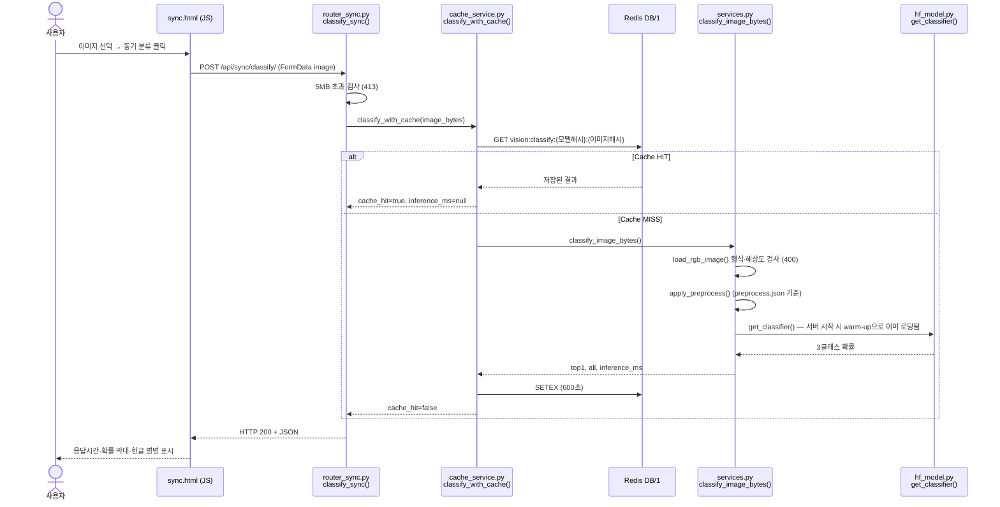
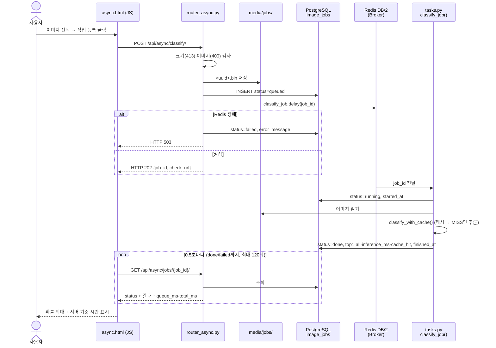
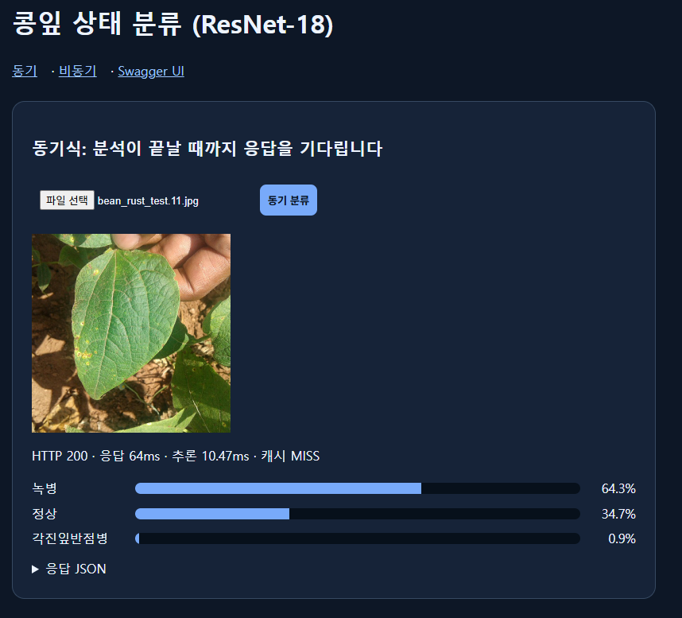
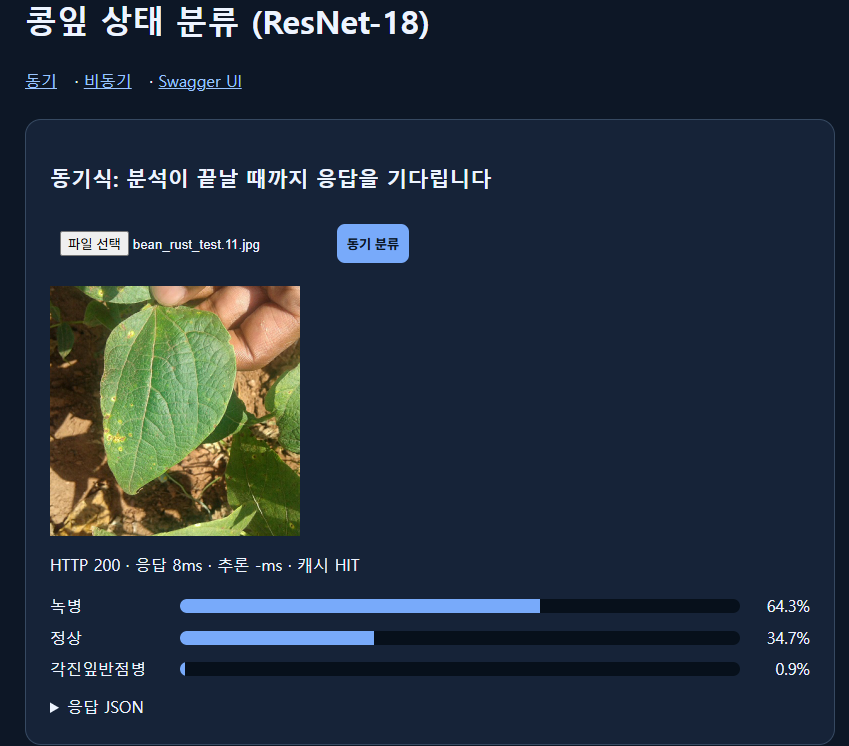
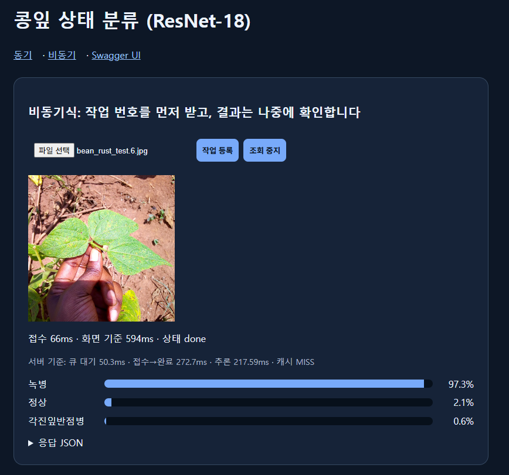
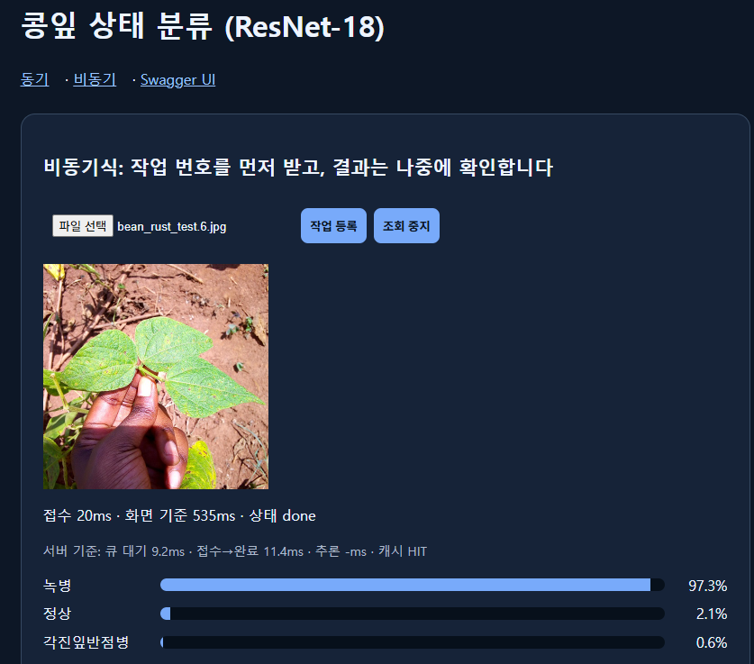
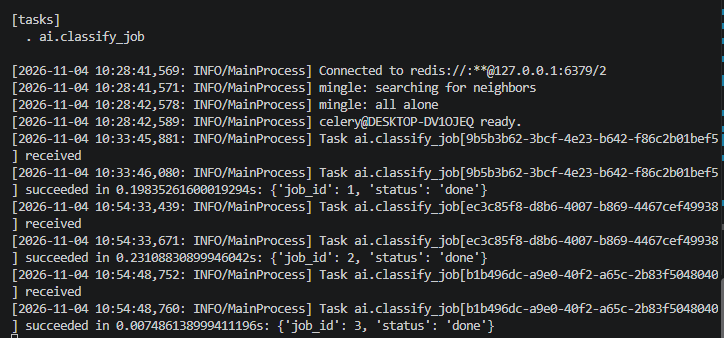

# 산출물 5. AI 분석 버튼 처리 흐름

## A. 동기 버튼 ("동기 분류")

## B. 비동기 버튼 ("작업 등록")

## C. 단계별 코드 대응표

| 단계 | 파일 | 함수·처리 | 결과 / 다음 단계 |
|---|---|---|---|
| 동기 1 | `templates/sync.html` | 버튼 `onclick` → `fetch('/api/sync/classify/')` | 응답시간 측정 시작 |
| 동기 2 | `ai/router_sync.py` | `classify_sync()` | 413 검사 → `classify_with_cache()` |
| 동기 3 | `ai/cache_service.py` | `classify_with_cache()` | HIT면 즉시 반환, MISS면 추론 후 저장 |
| 동기 4 | `ai/services.py` | `load_rgb_image()` → `apply_preprocess()` → `get_classifier()(image)` | `top1`, `all`, `inference_ms` |
| 동기 5 | `templates/sync.html` | `renderResult()` | 확률 막대 표시 |
| 비동기 1 | `templates/async.html` | `fetch('/api/async/classify/')` | 202면 폴링 시작 |
| 비동기 2 | `ai/router_async.py` | `enqueue_classify()` | 파일 저장 → DB `queued` → `classify_job.delay()` |
| 비동기 3 | `ai/tasks.py` | `classify_job()` (Celery Worker) | `running` → `done` / `failed` |
| 비동기 4 | `ai/router_async.py` | `get_job()` | 상태·결과·`queue_ms`·`total_ms` |
| 비동기 5 | `templates/async.html` | 폴링 루프 → `renderResult()` | 결과·서버 기준 시간 표시 |
| 공통 시작 | `main.py`, `ai/celery_app.py` | `lifespan()`, `@worker_init` → `warmup()` | 서버·워커 시작 시 모델 미리 로딩 |

## D. 실제 실행 결과

| 버튼 | 화면에 표시된 결과 | 증빙 |
|---|---|---|
| 동기 (처음 보는 이미지) | HTTP 200 · 응답 64ms · 추론 10.47ms · MISS · 녹병 64.3% |  |
| 동기 (같은 이미지 다시) | HTTP 200 · 응답 8ms · 추론 - · HIT |  |
| 비동기 (MISS) | 접수 66ms · 서버 기준 큐 대기 50.3ms · 접수→완료 272.7ms · 추론 217.59ms |  |
| 비동기 (HIT) | 접수 20ms · 서버 기준 큐 대기 9.2ms · 접수→완료 11.4ms |  |
| Worker 로그 | job 1~3이 `received` → `succeeded` (HIT는 0.007초) |  |

## E. 비교 정리

| 구분 | 동기 | 비동기 |
|---|---|---|
| HTTP 응답에 결과 포함 | O | X (202 접수만, 결과는 상태 조회로) |
| 추론 실행 프로세스 | FastAPI 서버 | Celery Worker |
| DB 기록 | X | O (`image_jobs`) |
| 서버가 추론 동안 붙잡히는가 | 예 | 아니오 |
| 사용하는 모델 | 같은 ResNet18 (`artifacts/e3_plus_aug`) | 같음 |

화면의 "화면 기준" 시간은 브라우저 폴링 간격(0.5초) 때문에 최대 0.5초 늦게 보인다. 그래서 서버가 DB에 기록한 `started_at`, `finished_at`으로 계산한 "서버 기준" 시간을 함께 표시했다.
