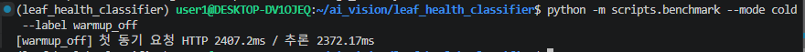
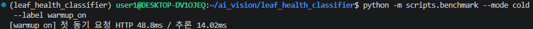
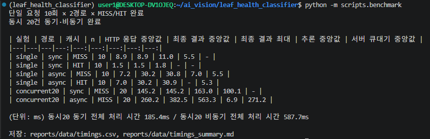
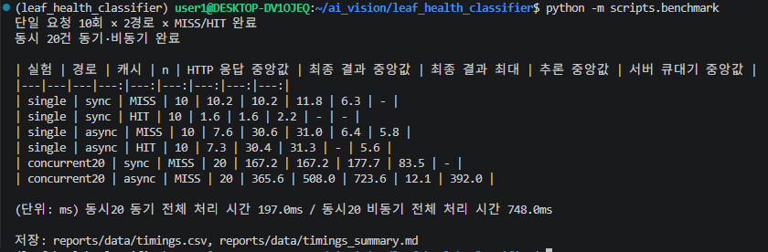

# 산출물 6. 성능 측정 및 비교 보고서

"성능"은 두 축으로 나눠서 보고한다.

| 축 | 질문 | 문서 |
|---|---|---|
| **모델 성능** | 얼마나 정확히 맞히는가 | [산출물 1](01_FineTuning_결과보고서.md) — Test 71.9% → 99.2% |
| **시스템 성능** | 얼마나 빨리, 많이 응답하는가 | **이 문서** |

비동기 처리의 접수 시간과 모델 정확도는 서로 다른 지표다. 비동기로 바꿔도 모델이 더 정확해지거나 추론이 빨라지지는 않는다.

## 1. 측정 방법

측정 스크립트 [`scripts/benchmark.py`](../scripts/benchmark.py)로 같은 조건에서 반복 측정했다. 브라우저 클릭은 사람마다 타이밍이 달라 반복 측정에 쓰지 않았다.

| 조건 | 값 |
|---|---|
| 모델 | `artifacts/e3_plus_aug` (FastAPI·Worker 동일) |
| 하드웨어 | i7-12700, RTX 3060 12GB, WSL2 ([`data/env.txt`](data/env.txt)) |
| 이미지 | `dataset/test` 128장을 고정 시드(42)로 섞어서 사용. 실험마다 서로 다른 이미지를 써서 MISS 조건 보장 |
| 캐시 | 측정 시작 시 Redis 캐시(DB/1)만 비움. 같은 이미지를 두 번 보내 1회차 MISS, 2회차 HIT |
| 단일 요청 | 경로별 이미지 10장 × (MISS, HIT) |
| 동시 요청 | 20개 스레드가 **동시에 출발** (`threading.Barrier`), 각자 다른 이미지 |
| Worker | `--pool=solo --concurrency=1` |
| 예열 | 측정 전 동기·비동기 각 1회 요청 (기록 제외) |
| 비동기 상태 조회 간격 | 단일 0.02초, 동시 0.05초 (브라우저 화면은 0.5초) |
| 통계 | 중앙값 (극단값 영향 감소) |
| 원본 | [`data/timings_gpu.csv`](data/timings_gpu.csv), [`timings_cpu.csv`](data/timings_cpu.csv), [`timings_gpu_pool30.csv`](data/timings_gpu_pool30.csv) |

**용어**
- **HTTP 응답**: 요청을 보내고 HTTP 응답을 받기까지 (동기는 결과 포함, 비동기는 202 접수만)
- **최종 결과**: 요청부터 분류 결과를 손에 쥐기까지 (비동기는 상태 조회로 `done`을 확인한 시점)
- **서버 기준 접수→완료**: DB의 `finished_at − created_at` (폴링 간격 영향 없음)

## 2. warm-up: 첫 요청 지연 제거

서버 재시작 직후 첫 동기 요청 1회 ([`data/cold_start.csv`](data/cold_start.csv),  )

| 서버 시작 방식 | 첫 요청 HTTP 응답 | `inference_ms` |
|---|---:|---:|
| `WARMUP=0` (교재 방식: 첫 요청 때 모델 로딩) | 2,407.2ms | 2,372.17ms |
| `WARMUP=1` (시작 시 미리 로딩) | **48.8ms** | 14.02ms |

→ 첫 요청 응답 **98.0% 단축 (약 49배)**. 서버 시작이 약 2.4초 늘어나는 대신, 첫 사용자가 기다리지 않는다.

## 3. GPU 환경 결과 ([`data/timings_summary_gpu.md`](data/timings_summary_gpu.md), )

| 실험 | 경로 | 캐시 | n | HTTP 응답 | 최종 결과 | 최종 결과 최대 | 추론 | 서버 큐대기 | 서버 기준 접수→완료 |
|---|---|---|---:|---:|---:|---:|---:|---:|---:|
| 단일 | 동기 | MISS | 10 | 8.9 | 8.9 | 11.0 | 5.5 | - | - |
| 단일 | 동기 | HIT | 10 | 1.5 | 1.5 | 1.8 | - | - | - |
| 단일 | 비동기 | MISS | 10 | 7.2 | 30.2 | 30.8 | 7.0 | 5.5 | 15.9 |
| 단일 | 비동기 | HIT | 10 | 7.0 | 30.2 | 30.9 | - | 5.3 | 7.0 |
| 동시 20 | 동기 | MISS | 20 | 145.2 | 145.2 | 163.0 | 100.1 | - | - |
| 동시 20 | 비동기 | MISS | 20 | 260.2 | 382.5 | 563.3 | 6.9 | 271.2 | 281.4 |

(단위: ms, 중앙값) 동시 20건 전체 처리 시간: 동기 185.4ms / 비동기 587.7ms

## 4. 캐시 효과

| 경로 | 지표 | MISS | HIT | 감소율 |
|---|---|---:|---:|---:|
| 동기 (GPU) | HTTP 응답 | 8.9 | 1.5 | 83.1% |
| 동기 (CPU) | HTTP 응답 | 19.9 | 1.9 | 90.5% |
| 비동기 (GPU) | 서버 기준 접수→완료 | 15.9 | 7.0 | 56.0% |

- HIT의 `inference_ms=null`은 **모델 추론을 생략했다**는 뜻이다. 0ms로 해석하지 않는다.
- 비동기 HIT의 최종 결과(30.2ms)가 MISS와 같은 이유: 결과는 더 빨리 준비되지만 클라이언트가 20ms마다 확인하므로, 확인 시점이 비슷해진다. 서버 기준으로는 HIT가 56% 빠르다.

## 5. CPU 환경 결과 (`CUDA_VISIBLE_DEVICES=""`, )

교재는 CPU 평가 환경을 기본으로 한다. 서버와 Worker를 GPU 없이 재시작해서 같은 측정을 반복했다.

| 실험 | 경로 | 캐시 | HTTP 응답 | 최종 결과 | 최종 결과 최대 | 추론 | 서버 큐대기 | 서버 기준 접수→완료 |
|---|---|---|---:|---:|---:|---:|---:|---:|
| 단일 | 동기 | MISS | 19.9 | 19.9 | 24.8 | 15.6 | - | - |
| 단일 | 동기 | HIT | 1.9 | 1.9 | 2.4 | - | - | - |
| 단일 | 비동기 | MISS | 7.0 | 55.3 | 56.8 | 18.4 | 5.6 | 28.2 |
| 단일 | 비동기 | HIT | 7.0 | 29.8 | 30.2 | - | 5.6 | 7.3 |
| 동시 20 | 동기 | MISS | 256.4 | 256.4 | 275.2 | 205.2 | - | - |
| 동시 20 | 비동기 | MISS | 256.6 | 495.2 | 737.4 | 16.6 | 351.6 | 372.7 |

(단위: ms) 동시 20건 전체 처리 시간: 동기 303.6ms / 비동기 763.9ms

## 6. 동기 vs 비동기 해석

### 6-1. 접수 응답: 추론이 느릴수록 비동기가 유리

| 환경 | 동기 응답 (MISS) | 비동기 접수 | 감소율 |
|---|---:|---:|---:|
| GPU (추론 5.5ms) | 8.9ms | 7.2ms | 19.1% |
| CPU (추론 15.6ms) | 19.9ms | 7.0ms | **64.8%** |

비동기 접수 시간은 GPU·CPU 모두 약 7ms로 **추론 시간과 무관하게 일정**하다. 동기 응답은 추론 시간만큼 늘어난다. 따라서 추론이 수백 ms~수 초인 모델(교재 감정분석 예시는 781ms)일수록 비동기 접수의 이점이 커진다. 이 프로젝트의 ResNet18은 추론이 매우 빨라(GPU 5.5ms) 이점이 작았다.

### 6-2. 최종 결과: 비동기가 항상 더 늦음

| 환경 | 동기 결과 | 비동기 서버 기준 완료 | 비동기 최종 확인 |
|---|---:|---:|---:|
| GPU 단일 MISS | 8.9ms | 15.9ms | 30.2ms |
| CPU 단일 MISS | 19.9ms | 28.2ms | 55.3ms |

비동기는 큐 대기(약 5.5ms) + DB 기록 + 상태 조회 간격이 더해진다. **비동기는 결과를 빨리 주는 기술이 아니라, 서버가 추론 동안 붙잡히지 않게 하는 기술**이다.

### 6-3. 동시 20건: 이 구성에서는 동기가 더 빠름

- 동기: 20개 요청이 서버 스레드에서 동시에 추론한다. GPU 경쟁으로 추론이 5.5ms → 100.1ms로 늘었지만 전체 185ms에 끝났다.
- 비동기: Worker가 1개(`solo`)라 20건을 **한 건씩 차례로** 처리한다. 큐 대기 중앙값 271ms, 전체 588ms.
- **비동기 접수 자체도 260ms로 느려졌다.** 모델이 관여하지 않는 구간이므로, 접수 과정(이미지 검증, 파일 저장, DB 기록, Redis 등록)이 동시 요청에서 병목이다.

## 7. 병목 개선 실험: 연결 풀 확대 (가설 기각)

**가설**: DB 연결 풀(기본 5+10)과 Redis 연결 풀(기본 10)이 동시 요청 20개보다 작아서 접수가 줄을 선다.
**실험**: `DB_POOL_SIZE=30`, `BROKER_POOL_LIMIT=30`으로 늘리고 같은 측정 반복 ([`data/timings_summary_gpu_pool30.md`](data/timings_summary_gpu_pool30.md), )

| 동시 20건 비동기 (GPU) | 기본값 | 풀 30 |
|---|---:|---:|
| 접수 응답 중앙값 | 260.2ms | 365.6ms |
| 최종 결과 중앙값 | 382.5ms | 508.0ms |
| 전체 처리 시간 | 587.7ms | 748.0ms |

**결과: 오히려 느려졌다 → 가설 기각.** 연결 수가 부족해서 기다린 것이 아니었다. 동시 요청 시 새 연결을 한꺼번에 많이 만드는 비용이 더 컸던 것으로 추정한다. 설정은 기본값으로 되돌렸다(`ai/config.py`에서 환경변수로 조정 가능하게만 유지).

**남은 원인 후보 (미검증)**: Uvicorn 서버 프로세스가 1개라서 20개 요청의 이미지 검증·파일 처리를 한 프로세스가 나눠 처리한다. 다음 개선 후보는 `uvicorn --workers N`(프로세스 여러 개)과 Celery Worker 동시 처리 수 증가다.

## 8. 결론

| 항목 | 결과 |
|---|---|
| warm-up | 첫 요청 2,407ms → 48.8ms (**98.0% 단축**) |
| 캐시 | 동기 응답 83~91% 단축, 비동기 서버 처리 56% 단축 |
| 비동기 접수 | 추론 시간과 무관하게 약 7ms. CPU에서 동기 대비 64.8% 빠름 |
| 비동기 최종 결과 | 큐·조회 비용으로 동기보다 늦음 |
| 동시 요청 | 현재 구성(서버 1 프로세스, Worker 1개)에서는 동기가 더 빠름 |
| 연결 풀 확대 | 가설 기각 |

교재 예시처럼 "비동기가 260배 빠르다"는 결과는 **추론이 느린 모델의 HTTP 응답 시간**에 해당한다. 이 프로젝트처럼 추론이 빠른 모델에서는 그 차이가 작고, 최종 결과는 오히려 늦다. 비동기 구조는 추론이 무거워지거나(큰 모델, CPU 서버) 요청이 몰려 Worker를 늘릴 수 있을 때 가치가 커진다.

## 9. 비교 조건 점검

- [x] 같은 모델 체크포인트 (`e3_plus_aug`)
- [x] MISS 대 MISS, HIT 대 HIT 비교
- [x] 같은 하드웨어, GPU·CPU 조건 분리
- [x] 첫 로딩은 warm-up 실험으로 따로 측정, 반복 측정에서는 예열 1회 제외
- [x] 원본 CSV와 요약표 일치
- [ ] 동시 요청 실험은 조건별 1회 실행 → 실행마다 변동 가능성 있음 (한계)
