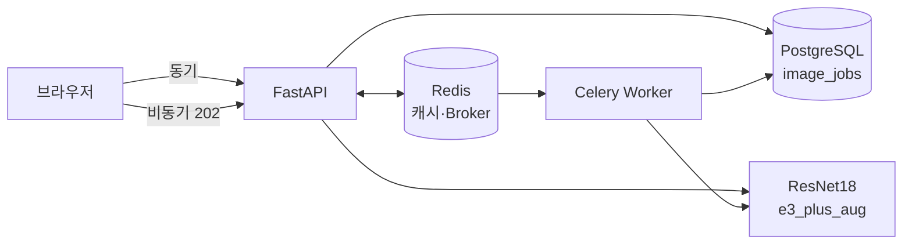

# 콩잎 질병 분류 Vision AI 서비스 — 최종 기술보고서

## 1. 프로젝트 정보

| 항목 | 내용 |
|---|---|
| 과제 | 콩잎 사진 1장을 3클래스로 분류하는 AI 웹 서비스 (동기·비동기) |
| 클래스 | `angular_leaf_spot` 각진잎반점병 / `bean_rust` 녹병 / `healthy` 정상 |
| 데이터 | Hugging Face `AI-Lab-Makerere/beans` (Train 1,034 / Val 133 / Test 128) |
| 기준 모델 | `microsoft/resnet-18` (ImageNet 1,000클래스 → 3클래스 출력층 교체) |
| 최종 모델 | `artifacts/e3_plus_aug` (2단계 학습 + 데이터 증강) |
| 구조 | FastAPI·Celery Worker (WSL2, GPU) + Redis·PostgreSQL (Docker Compose) |
| 저장소 | https://github.com/simpson92/leaf-health-classifier |

## 2. 핵심 결과 한눈에 보기

| 영역 | baseline / 교재 방식 | 이 프로젝트 | 근거 |
|---|---:|---:|---|
| **Test 정확도** | 71.9% | **99.2%** | [산출물 1 §6](01_FineTuning_결과보고서.md) |
| **녹병 Recall** | 53.5% | **97.7%** | 같은 곳 |
| 촬영 조건 변화 평균 정확도 | 68.7% | **95.5%** | [산출물 1 §4](01_FineTuning_결과보고서.md) |
| 서버 시작 후 첫 요청 | 2,407ms | **48.8ms** | [산출물 6 §2](06_성능비교_보고서.md) |
| 같은 이미지 재요청 (동기) | 8.9ms | **1.5ms** (캐시) | [산출물 6 §4](06_성능비교_보고서.md) |
| 비동기 접수 (CPU) | 동기 19.9ms | **7.0ms** | [산출물 6 §6](06_성능비교_보고서.md) |
| 실환경 테스트 | - | 18건 PASS | [산출물 7](07_기능테스트_오류분석.md) |

## 3. 모델 학습 — 무엇을 왜 바꿨나

**문제**: 교재 기본 설정(Backbone 고정, 분류 헤드만 3 epoch)은 Val 76.7%, Test 71.9%였다. 특히 녹병을 절반 가까이 놓쳤고, 녹병과 각진잎반점병을 서로 혼동했다(Test 오분류 36건 중 20건).

**원인 판단**: 두 병 모두 잎의 작은 반점이라 ImageNet 사전학습 특징을 그대로 쓰면 구분이 어렵다. Backbone까지 조정해야 한다.

**접근**: 한 번에 하나씩 바꾸고 같은 Val로 비교했다.

| 실험 | 변경 | Val | 강건성 평균 | 판단 |
|---|---|---:|---:|---|
| E0 | 교재 그대로 (Head-only) | 76.7% | 68.7% | baseline |
| E1 | 교재 코드로 전체 학습 | 97.0% | 88.1% | Backbone 학습이 가장 큰 개선 (+20%p). 다만 1 epoch 이후 과적합 |
| E2 | 2단계 학습·차등 학습률·코사인 스케줄·label smoothing·조기 종료 | 100% | 93.2% | 안정적이지만 Train 100% → 외우기 시작 |
| **E3** | E2 + 데이터 증강 (색조 제외) | 99.2% | **95.5%** | **최종 선택**. 밝기 변화에 특히 강함 (+9%p) |
| E4 | E3 + CLAHE 조명 보정 | 99.2% | 93.0% | **가설 기각**. 밝은 조건에서 오히려 −11%p |

**검증 방법에서 신경 쓴 점**
- Val 133장에서 E2~E4의 차이가 1장 이내라 Val 정확도로는 고를 수 없었다. 그래서 **Val 이미지에 학습 때보다 강한 촬영 조건 변화를 주는 강건성 평가**를 만들었다.
- 모델 선택 기준(Val → 강건성 → Val Loss)을 **결과를 보기 전에** 정했다.
- Test는 최종 모델을 정한 뒤 1회만 평가했다. Test 정확도(99.2%)가 Val과 같은 수준이라 Val에 과하게 맞춘 결과가 아니다.

## 4. 시스템 구조와 개선

자세한 구조: [산출물 2](02_시스템_아키텍처.md) · API: [산출물 3](03_API_명세서.md) · DB: [산출물 4](04_DB_구조_작업이력.md) · 버튼 처리 흐름: [산출물 5](05_AI버튼_처리흐름.md)

| 교재 대비 개선 | 효과 |
|---|---|
| FastAPI·Worker를 WSL2에서 실행 (Docker는 Redis·PostgreSQL만) | GPU 사용 가능 |
| 서버·Worker 시작 시 모델 미리 로딩 (warm-up) | 첫 요청 2,407ms → 48.8ms |
| `image_jobs`에 `started_at`, `finished_at` 추가 | 큐 대기·처리 시간을 서버 기준으로 측정 |
| 학습·서빙 전처리 공유 (`preprocess.json`) | 전처리 불일치 방지 |
| 모델 경로를 프로젝트 기준 절대경로로 변환 | 실행 위치와 무관하게 동작 |
| 결과 화면에 확률 막대·한글 병명·서버 기준 시간 | 결과 해석 용이 |

## 5. 성능 비교 결론 ([산출물 6](06_성능비교_보고서.md))

- **비동기 접수 시간은 추론 시간과 무관하게 약 7ms**로 일정하다. 동기는 추론 시간만큼 늘어나므로, 추론이 느린 환경(CPU)에서 비동기 접수가 64.8% 빨랐고 GPU에서는 19.1%였다.
- **최종 결과는 비동기가 항상 더 늦다**(큐 대기·상태 조회). 비동기는 결과를 빨리 주는 기술이 아니라 서버가 붙잡히지 않게 하는 기술이다.
- 동시 20건에서는 현재 구성(서버 프로세스 1개, Worker 1개)상 동기가 더 빨랐다. 연결 풀 확대로 개선하려 했으나 **실험 결과 가설이 기각**되어 기본값을 유지했다.
- 교재의 "비동기 260배" 예시는 추론 781ms 모델의 HTTP 응답 기준이다. 추론 5ms인 이 모델에서는 같은 효과가 나지 않는다는 것을 실측으로 확인했다.

## 6. 기능 검증 ([산출물 7](07_기능테스트_오류분석.md))

- 모의 테스트 5건 + 실환경 통합 테스트 18건 모두 PASS
- 장애 상황: Worker 중지(작업 대기 후 재시작 시 처리), Redis 중지(동기는 캐시 없이 계속 동작, 비동기는 503 + DB `failed` 기록), Redis 복구(약 6초 후 정상화)

## 7. 관련 연구

| 연구 | 내용 | 이 프로젝트와의 관계 |
|---|---|---|
| Mohanty et al. (2016), *Frontiers in Plant Science* 7:1419 | PlantVillage 54,306장, 38클래스, 99% 이상. 통제된 촬영 조건의 데이터 | 실험실 조건 데이터의 한계 → 촬영 조건 변화 강건성 평가의 동기 |
| Image based anthracnose and red-rust leaf disease detection (TELKOMNIKA, 2022) | 망고 잎, ResNet18/34/50/101 비교, ResNet18 98% 채택 | ResNet18이 잎 질병 분류에 충분하다는 근거 |
| Dhawan et al. (2023), *ELCVIA* | 망고 잎 약 2,000장, ResNet18 전이학습 99.88% | 비슷한 규모 데이터에서의 ResNet18 전이학습 |
| Wani et al. (2025), *Annals of Data Science* | 사과 잎 4클래스, ResNet18 등 전이학습 + 이미지 향상 97.25% | 전처리·증강으로 성능 개선 |
| Tomato leaf ResNet18/50/101 (IIETA) | 토마토 잎, 데이터 증강 효과 분석 | 증강 효과 검증 |
| Development of an AI Web Based System for Classification of Tomatoes Disease (2025) | 웹 서비스 배포 후 지연시간·응답시간·처리량 측정 | 시스템 성능 측정 항목 참고 |

참고 자료(논문 아님): FastAPI + Celery 비동기 ML 추론 PoC ([SimpleITAutomation/async-ml-inference](https://github.com/SimpleITAutomation/async-ml-inference)).

기존 연구는 대부분 모델 정확도만 보고하거나 동기 방식 웹앱이다. 이 프로젝트는 같은 모델을 동기·비동기 두 경로로 서빙하고, **추론 속도에 따라 비동기의 효과가 어떻게 달라지는지**를 실측했다.

## 8. 구현한 것과 제안만 한 것

| 구분 | 항목 | 상태 |
|---|---|---|
| 구현·측정 | 2단계 학습, 차등 학습률, 스케줄, label smoothing, 조기 종료 | 완료 (E2) |
| 구현·측정 | 데이터 증강 | 완료 (E3, 채택) |
| 구현·측정 | CLAHE 조명 보정 (교과 9 응용) | 완료 (E4, **기각**) |
| 구현·측정 | 강건성 평가, 클래스별 지표·혼동행렬, Test 평가 | 완료 |
| 구현·측정 | warm-up, 처리 시간 컬럼, 성능 측정 스크립트 | 완료 |
| 구현·측정 | 연결 풀 확대 | 완료 (**기각**) |
| 제안 (미구현) | **확신도 기반 "확인 필요" 판정**: 확신도가 낮은 결과(예: 60% 미만)를 자동 확정하지 않고 사람 확인으로 분리. 유일한 Test 오분류(60.5%)와 낮은 확신도 정답 사례(53.6%, 64.3%)가 이 범위에 있음 | 임계값을 Val로 정하고 보류율·오답률을 함께 측정해야 함 |
| 제안 (미구현) | Grad-CAM으로 모델이 병반을 보고 판단하는지 확인 | 설명 도구이며 정확도를 직접 올리지는 않음 |
| 제안 (미구현) | Uvicorn `--workers N`, Celery Worker 동시 처리 수 증가 | 동시 요청 접수 병목의 다음 후보 |
| 제안 (미구현) | HSV 병반 면적비 + CNN 점수 결합 | 교재 6-2 제안 |

## 9. 한계와 향후 과제

- **데이터 규모**: Val 133장, Test 128장이라 1장이 약 0.8%p. 작은 차이는 구분이 어렵다.
- **재현 변동**: 모든 학습은 seed 42로 1회씩. 시드별 변동은 측정하지 않았다. 동시 요청 측정도 조건별 1회다.
- **강건성 평가**: 인공적인 변형이며 실제 다른 현장 사진이 아니다.
- **데이터 출처**: 한 지역(우간다) 사진이라 다른 환경의 콩잎 성능은 알 수 없다.
- **향후**: 시드 여러 개로 반복 실험, 확신도 기반 "확인 필요" 판정 구현, 서버·Worker 프로세스 확장 실험

## 10. 산출물 목록

| 번호 | 문서 |
|---|---|
| 1 | [Fine-tuning 결과보고서](01_FineTuning_결과보고서.md) |
| 2 | [시스템 아키텍처](02_시스템_아키텍처.md) |
| 3 | [API 명세서](03_API_명세서.md) |
| 4 | [DB 구조·작업이력](04_DB_구조_작업이력.md) |
| 5 | [AI 버튼 처리흐름](05_AI버튼_처리흐름.md) |
| 6 | [성능비교 보고서](06_성능비교_보고서.md) |
| 7 | [기능테스트·오류분석](07_기능테스트_오류분석.md) |
| 8 | 최종기술보고서 (이 문서) + 프로젝트 루트 `README.md` |
| 증빙 | [`evidence/`](evidence/) 캡처 44장, [`data/`](data/) 측정 원본 |
